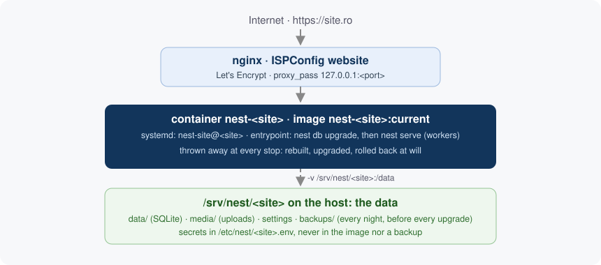

# Nest sites on a server with ISPConfig (nginx)

Every Nest site on the server runs the same way: a **container** built from the site's
repository and Nest, run by **systemd**, behind an **ISPConfig website** (nginx, Let's
Encrypt). The tools for it are in Nest's `deploy/site/`; each site's repository has its own
`deploy/` folder (its settings, its `.env` example, its nginx directives, its `DEPLOY.md`).



**The data are never in the container.** A site's workspace (its SQLite databases, its
uploaded files, its settings, its backups) is a folder on the host, `/srv/nest/<site>`,
mounted at `/data`. The container is thrown away at every stop; a rebuild, a restart, an
upgrade or a crash leaves the data where they are. The secrets are in `/etc/nest/<site>.env`
(root only), never in a repository nor in a backup.

## What is where

| | |
|---|---|
| `/opt/nest/src/nest`, `/opt/nest/src/<site>` | the sources, side by side (git checkouts) |
| `/etc/nest/<site>.conf` | where it runs: `PORT`, `DATA`, `IMAGE`, `MEMORY` (from the site's `deploy/site.conf.example`) |
| `/etc/nest/<site>.env` | its secrets and production settings (from `deploy/<site>.env.example`) |
| `/srv/nest/<site>` | its workspace: `data/`, `media/`, `backups/` (owned by uid 10001, the image's user) |
| `nest-<site>:current`, `:previous` | its image, and the one before (for a rollback) |
| `nest-site@<site>.service` | systemd runs it; `nest-site-backup@<site>.timer` backs it up every night |
| `/usr/local/bin/nest-site` | the tool: build, upgrade, rollback, backup, restore, any nest command |
| `nest-host.service`, `/etc/nest/host.conf` | the keeper's hands on the server: restart, back up, upgrade, roll back through `nest-site` (optional) |

| site | port | domain |
|---|---|---|
| regionalisme | 8200 | regionalisme.ro |
| morlaca | 8300 | morlaca.ro |
| transilpedia | 8310 | transilpedia.ro |
| gari | 8400 | gari.ro |
| voievodate (later) | 8500 | voievodate.ro |
| registry | 8600 | registry.nest-framework.org (its own guide: `registry-deploy.md`) |

## Once: the server

Docker (`docker.io` or Docker's own packages), git, curl, openssl. Then Nest's tools:

```sh
sudo install -d -m 0750 /opt/nest/src /etc/nest
sudo git clone git@github.com:NestWebFramework/nest.git /opt/nest/src/nest   # a deploy key, read only
sudo install -m 0755 /opt/nest/src/nest/deploy/site/nest-site /usr/local/bin/
sudo install -m 0644 /opt/nest/src/nest/deploy/site/nest-site*@.* /etc/systemd/system/
sudo systemctl daemon-reload
```

## A site

Each site's `deploy/DEPLOY.md` gives its own commands; they are, for a site `S`:

```sh
sudo git clone git@github.com:NestWebFramework/S.git /opt/nest/src/S
sudo install -m 0640 /opt/nest/src/S/deploy/site.conf.example /etc/nest/S.conf
sudo nest-site init S            # /srv/nest/S, and /etc/nest/S.env with a fresh secret
sudo editor /etc/nest/S.env       # the rest, from deploy/S.env.example
sudo nest-site build S            # its image
sudo nest-site restore S /srv/nest/S/backups/S-<stamp>.tar.gz    # its data, from a backup
sudo systemctl enable --now nest-site@S nest-site-backup@S.timer
```

Then the ISPConfig website: domain, auto-subdomain `www.`, PHP disabled, Let's Encrypt on,
the SEO redirect from `www.`; under **Options → nginx Directives**, the site's
`deploy/nginx.conf` (it proxies to `127.0.0.1:<port>`, lets uploads and live updates through).

For the [keeper](operate/keeper.md) to watch the site, give its agent a token:
`nest agent token S --control` prints the token for the keeper and a
`NEST_S__AGENT__CONTROL_TOKEN=sha256:…` line for `/etc/nest/S.env`, followed by
`sudo systemctl restart nest-site@S`. Until then the agent answers nobody.

## Optional: restarts and upgrades from the keeper

The [keeper](operate/keeper.md) watches the sites through their agents. To also restart,
back up, upgrade and roll them back from its pages, install the host helper:

```sh
sudo install -m 0755 /opt/nest/src/nest/deploy/site/nest-host /usr/local/bin/
sudo nest-host token        # a token for the keeper, and the line for host.conf
sudo editor /etc/nest/host.conf
sudo install -m 0644 /opt/nest/src/nest/deploy/site/nest-host.service /etc/systemd/system/
sudo systemctl daemon-reload && sudo systemctl enable --now nest-host
```

`/etc/nest/host.conf` (one `KEY=VALUE` per line, no comment after a value):

```text
TOKEN_SHA256=sha256:…
BIND=172.17.0.1
PORT=8090
ALLOW=restart backup upgrade rollback
```

`BIND` is `127.0.0.1` when the keeper runs on the host itself, and the Docker bridge's
address (`172.17.0.1`) when the keeper is a container. The helper refuses any public
address. The keeper's environment then gets:

```text
NEST_KEEPER__KEEPER__HOST_URL=http://172.17.0.1:8090
NEST_KEEPER__KEEPER__HOST_TOKEN=nh_…
```

Each job and who asked for it is written to `/var/lib/nest-site/host-jobs.log` and to the
journal (`journalctl -u nest-host`).

## Images from Docker Hub

A site's image can be built on the server from its sources, or built once on a
development machine, pushed to Docker Hub and pulled by the server:

```sh
deploy/site/nest-images build gari     # from Nest's repository: miraur/nest-sites:gari-0.1.0, gari-latest, gari-<commits>
deploy/site/nest-images push gari      # only from committed code
```

On the server, `PULL=miraur/nest-sites` and `TAG=gari-latest` (or a version, `gari-0.1.0`) in
`/etc/nest/gari.conf` makes `nest-site build` and `nest-site upgrade` pull the image
instead of building it, and the server needs no sources. Everything else stays: the data
in `/srv/nest/gari` (never in the image), the backup before an upgrade, the migrations,
the health wait and the rollback to `:previous`.

Nest's own images (`nest-docsite`, `nest-keeper`) are public, each in its own repository.
The sites' images are private and share one repository, `miraur/nest-sites`, a tag per site
(`gari-latest`, `morlaca-latest`, ...): Docker Hub's free plan has one private repository,
and the layers the sites share (Python, Nest) are stored once. Create it as private before
the first push (a push creates a missing repository with the account's default
visibility), and log the server in once with `sudo docker login` and a read-only access
token.

## Upgrades and migrations

```sh
sudo nest-site upgrade S
```

1. pulls Nest's and the site's sources (`git pull --ff-only`): what is deployed is what is
   pushed;
2. builds a new image (`:current`; the one before becomes `:previous`);
3. **backs up the data** (the databases copied consistently while the site runs);
4. restarts it: the image's entrypoint runs `nest db upgrade` (every module's migrations)
   before it serves; a production site never migrates by itself otherwise;
5. waits until `/healthz` answers. If it does not, it **rolls back by itself**: the image
   before, and the data as the backup of step 3 has them (the migrations undone with them).

`sudo nest-site rollback S` does step 5 by hand; `sudo nest-site nest S db status /src/app`
shows each module's migrations.

## Backups

`nest-site-backup@S.timer` makes one every night into `/srv/nest/S/backups/` (`KEEP` in the
`.conf`, 14 by default); `sudo nest-site backup S` makes one now. Each is one archive: the
databases (a consistent copy), the files, the settings; not the `.env`. **Copy them off the
server** (rsync, or the hosting's backup), and try a restore now and then:
`sudo nest-site restore S <archive>`.

## Day to day

```sh
sudo nest-site logs S                       # its log (journalctl -u nest-site@S)
sudo systemctl restart nest-site@S          # restart (the data stay)
sudo nest-site nest S check /src/app        # what production asks of it
sudo nest-site nest S <command> /src/app …  # any nest command, in the running site
```

## Later: a database and file server

When a site outgrows SQLite (many writers at once: a game, not a dictionary), its `.env`
binds PostgreSQL and S3/MinIO instead (the lines are in each `.env` example); move its data
with `nest backup` and the database's own import. The containers and this procedure stay
the same.
