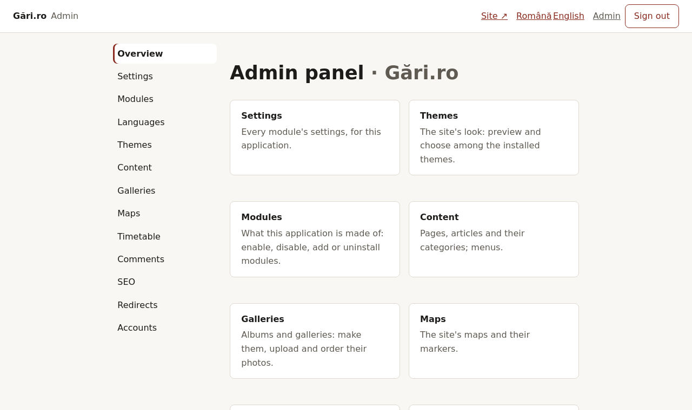
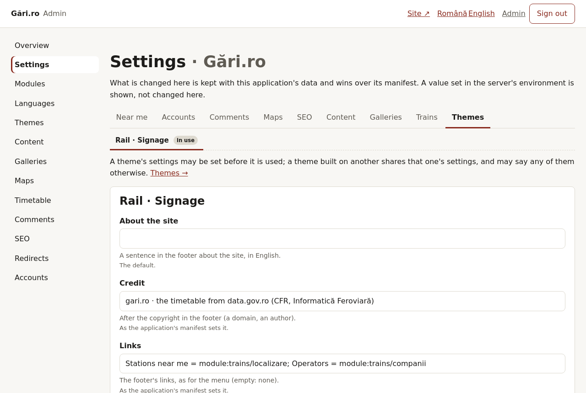
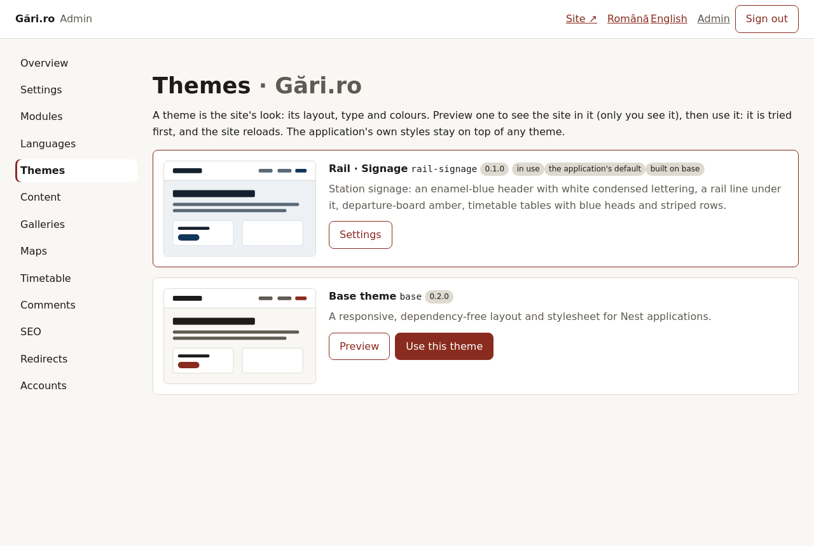

# The admin panel

Every Nest application has one admin panel, and nobody writes it. The `admin` module
is a shell; each module the application includes adds its own pages to it. Two sites
made of the same modules have the same panel. A game made
with the Saga engine has the engine's panel.

## Adding it

Include `admin` once, at a route. It needs `auth` for accounts:

```yaml
modules:
  - name: auth
    route: /cont
    core: true
  - name: admin
    route: /admin
    core: true
```

Marking both `core: true` means nobody can disable the panel from inside the panel.
An application without the `admin` module serves no admin pages; if its modules
have some, it says so at start.

## Home

The home page (`/admin/`) shows a tile for each part of the panel the signed-in user
may open, with a one-line description.



- Administrators see **Settings**, **Themes** and **Modules** first.
- Then a tile per module page, in the order the modules ask for (`order` in their
  manifest), showing only those the user's roles open.

### The waiting badges

Some tiles carry a number: how many things wait for someone. The comments module
counts comments waiting for a moderator; the glossary counts visitors' proposals
waiting for an editor. Any module can add one by answering the `admin.waiting`
lookup with a count; the home page gathers them. A badge is shown only when the
count is not zero.

## Roles

The panel shows each person only what their roles open.

| Role | What it opens |
|---|---|
| `admin` | Everything, including Settings, Themes, Modules, Languages and Accounts. `admin` has every other role. |
| `editor` | Content, galleries, maps, dictionaries, SEO, redirects, translations, the timetable |
| `moderator` | Comments and the forum |
| `gamemaster` | The Saga engine's pages (servers, the land, tools), in a game |

Roles are given in **Accounts**, or when an account is created:

```sh
uv run nest auth create-user APP ana@example.org --role editor --password-stdin
```

## Settings

**Settings** (`/admin/settings`, administrators only) holds every package's settings,
a tab per module, in the order the application starts them. Each setting shows its
label, its description and its current value, and saving writes it to the
workspace's settings store, where it wins over the manifest's value.

- A value set in the **environment** (`NEST_<APP>__<MODULE>__<KEY>`) is shown but
  locked: the environment always wins.
- A **secret** is never shown.
- A setting can be **reset** to the value it would have without the panel.
- A module may check values before they are saved and refuse wrong ones with a
  message.
- Most changes apply at once. A setting marked `restart: true` decides which routes
  exist, so saving it remakes the application.

Only settings a package marks as editable appear here (settings are editable unless
the manifest says `editable: false`).

### The Themes tab

The last tab, **Themes**, holds the settings of every installed theme, each theme in
a tab of its own under it, the theme in use first. A theme's settings are things like
its tagline, its menu or its footer links. The values an application gives in
`application.theme_settings` are its starting values.



## Themes

**Themes** (`/admin/themes`, administrators only) lists the installed themes, each
drawn in its own colours, with badges for the one in use, the application's default,
and the theme it is built on.



| Button | What it does |
|---|---|
| **Preview** | Shows *you* the site in that theme for up to an hour, with a bar to go back. Everyone else still sees the theme in use. |
| **Settings** | Opens the theme's tab under Settings → Themes |
| **Use this theme** | Tries the theme first (renders the home page, a missing page and the panel's frame), keeps the choice in the workspace, and reloads the site |

A theme that cannot render those pages is refused, so a broken theme can never take
the site, or the panel needed to switch back, down with it. The page ends with the
latest changes: who switched, to what, and whether it worked. See
[Themes](../themes.md).

## Modules

**Modules** (`/admin/modules`, administrators only) shows what the application is
made of: core modules (locked), enabled, disabled, and installed but not used, each
with what it needs and what needs it. From there a module is disabled, enabled, added
at an address, or uninstalled (its name typed to confirm). The page shows each step
of a change and a log of the latest ones (kept in `data/modules.log`).

It can also search the Nest registry for packages that work with this Nest. Those
are read-only here: the server's administrator installs packages, the panel only
enables what is installed. See [Modules and applications](modules-and-applications.md).

## Languages

**Languages** (`/admin/languages`, administrators only) chooses which languages the
site is in and which one is the default. The manifest's `application.languages` is
the starting set; the choice is kept in the workspace and applied by remaking the
site. Adding a language changes no table: translated text is stored as rows. See
[Languages](../languages.md).

## Accounts

**Accounts** comes from the `auth` module (at `/admin/auth`, administrators only). It
lists every account with a search box, and opens one to:

- change its roles;
- make it active or inactive (an inactive account cannot sign in);
- sign it out everywhere, ending all its sessions.

Whether visitors may register themselves is the `auth` module's
`allow_registration` setting, off by default.

## Module pages

Each module with admin pages is mounted at `<admin route>/<module>`:

| Page | Module | Role | What it is for |
|---|---|---|---|
| Content | `content` | editor | Pages, articles, categories, the trash, revisions |
| Dictionaries | `glossary` | editor | Dictionaries, terms, visitors' proposals |
| Galleries | `gallery` | editor | Albums and galleries, uploads, the photos' order |
| Maps | `maps` | editor | Maps and their markers |
| Comments | `comments` | moderator | Comments waiting, approved, and marked spam |
| Forum | `forum` | moderator | Boards, topics and posts |
| SEO | `seo` | editor | How each page shows in search results, and what is missing |
| Redirects | `redirects` | editor | Old addresses and their hit counts |
| Translations | `translations` | editor | What is missing or outdated in each language |
| Accounts | `auth` | admin | Accounts and roles |

The guides describe them: [Content and media](content-and-media.md),
[Community](community.md), [Search and SEO](search-and-seo.md).

A module declares its listing in its manifest:

```yaml
admin:
  title: Galleries
  order: 14
  role: editor
  description: "Albums and galleries: make them, upload and order their photos."
```

and gives its pages with `host.admin(router)` in its setup. See
[A module](../develop/a-module.md).

## Its frame: standalone or site

By default the panel is a page of its own (`admin_frame: standalone`): not the site's
theme or menus, only what working in the panel needs, styled with the theme's colours.
An application can instead put the panel inside the site's own frame:

```yaml
application:
  admin_frame: site
```

The panel's language can be limited too: `application.admin_languages` lists the
languages it can be read in (empty: the site's languages).
