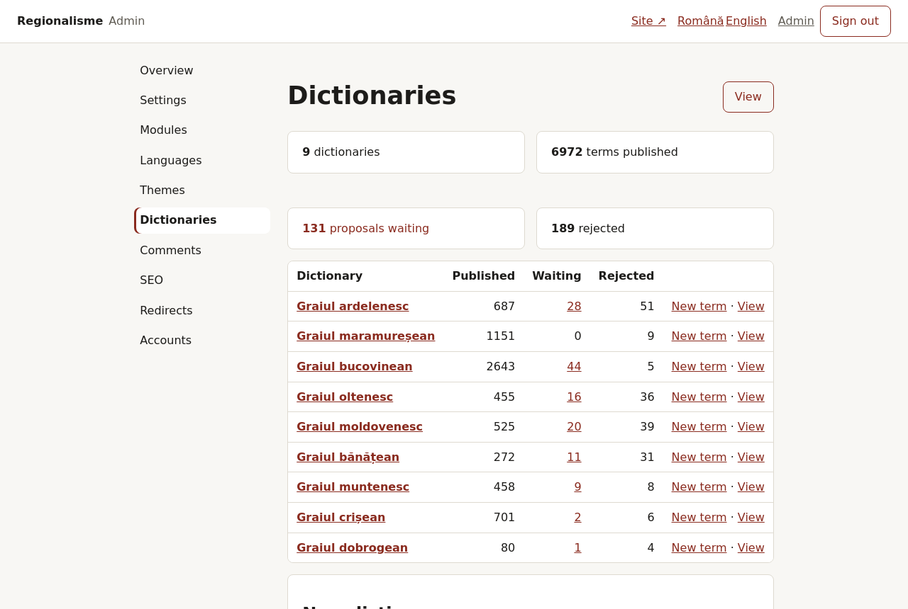
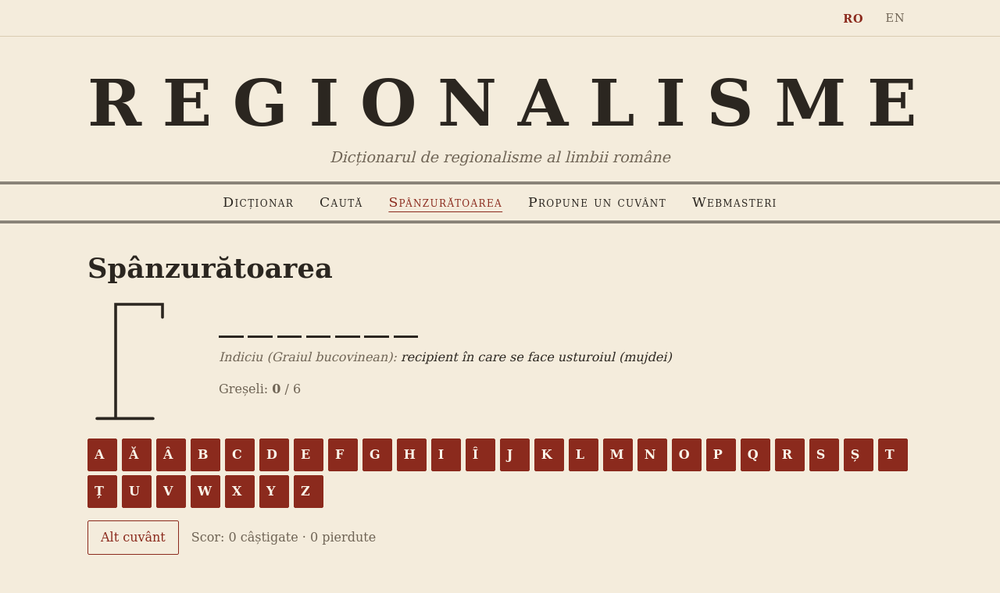

# Community

These modules let visitors take part: comment, discuss, write to each other, propose
words, play, and find what is near them. Each is a standalone module, so a game, a
dictionary and a village site use the same forum or comments, each in its own look.

## Comments

`comments` adds threaded comments to anything. The subject of a thread is a name,
not a foreign key (`"content.entry:12"`, `"glossary.term:7"`), so any module's
records can be commented without the comments module knowing them.

```yaml
modules:
  - name: comments
    route: /comentarii
    config:
      allow_guests: true
```

A page embeds a thread in its template, only when the application has the module:

```html
{{ comments("content.entry:" ~ entry.id) }}
```

The content module's pages and the glossary's term pages already do this.

### Who may comment, and who waits

| Setting | Default | Meaning |
|---|---|---|
| `allow_guests` | false | Whether people who have not signed in may comment |
| `moderation` | `guests` | Whose comments wait for a moderator: `none`, `guests` or `all` |
| `max_depth` | 3 | How deep replies nest; a deeper reply sits beside its parent |
| `min_seconds` | 3 | A form sent back sooner than this after it was shown is refused |
| `per_hour` | 10 | Comments a guest may send per address per hour |

Members with the `moderator` role are always published at once. Bodies are plain
text, shown with paragraphs, and links get `rel="nofollow ugc"`.

### Moderation

Moderators work at **Admin → Comments**: the comments waiting, those approved and
those marked spam, each changed with one click. The panel's home shows how many wait,
as a badge on the Comments tile.

### Spam defences

Robots meet several cheap checks before a comment is stored:

- **A signed subject.** The form carries the thread's subject signed with the site's
  key, so nobody can post to a thread a page did not offer.
- **A honeypot.** A field people cannot see; robots fill it, and are refused.
- **A minimum time.** A form sent back within `min_seconds` is refused.
- **A per-address limit** for guests (`per_hour`). The address is kept only as a
  keyed hash, never in clear.

Comments come in from old sites with `nest comments import-wordpress APP dump.sql`
and `nest comments import-glossword APP dump.sql`. They are attached to the pages the
old posts became, found through lookups the content and glossary modules answer.

## Forum

`forum` has boards, topics and posts.

```sh
uv run nest forum add-board APP "General" --description "Anything about the site."
uv run nest forum boards APP
```

| Setting | Default | Meaning |
|---|---|---|
| `public_read` | true | Whether people who have not signed in may read |
| `posts_per_minute` | 5 | Posts a member may send per minute |
| `edit_minutes` | 30 | How long an author may edit a post |
| `topics_per_page`, `posts_per_page` | 30 | Paging |

Posting is for members. Moderators pin, lock and hide in the topics themselves;
**Admin → Forum** shows the boards.

**Replies arrive live.** A new reply is pushed over Server-Sent Events to everyone
reading the topic, so it appears without a reload. Without JavaScript the form posts
and the page reloads at the new post.

## Messages

`messages` holds private conversations between members.

| Setting | Default | Meaning |
|---|---|---|
| `max_recipients` | 10 | People one conversation may start with |
| `per_hour` | 60 | Messages a member may send per hour |

- **Privacy.** Members write to each other by email, or by name when it is
  unambiguous. Only participants see a conversation; anyone else gets a 404.
- **Live delivery.** Each member has their own channel that only they may follow. A
  new message appears in the open conversation and the inbox refreshes.
- **An unread badge.** A layout shows the unread count with
  ``.

## Notifications

`notifications` shows short messages, called toasts, after an action: "Saved.",
"Deleted.", "Sent.". It has no pages and needs no route:

```yaml
modules:
  - name: notifications
```

A module says `toast(request, _("Saved."))` whatever it answers next. After a
redirect, the message travels in a signed, short-lived cookie that the next page
reads once; in an htmx answer it goes in a header and shows at once. The messages are
read by screen readers too. Without this module, toasts are silently dropped, so
include it in any site with an admin panel.

## Glossary proposals

The `glossary` module (regionalisme.ro's dictionaries) can let visitors propose new
words and meanings, which an editor approves one by one.

```yaml
  - name: glossary
    route: /
    config:
      proposals: true
```

| Setting | Default | Meaning |
|---|---|---|
| `proposals` | false | Visitors may propose words and definitions at `<route>/propose` |
| `proposals_per_hour` | 5 | Proposals a visitor may send per address per hour |
| `proposals_min_seconds` | 3 | A proposal sent sooner than this after its form was shown is refused |

The form uses the same defences as comments: a honeypot, a signed time stamp, and a
per-address limit kept as a keyed hash. Editors judge proposals at
**Admin → Dictionaries → Proposals**, and the Dictionaries tile shows how many wait.
Approved, a meaning for a word already in the dictionary becomes another of its
senses. Rejected, it stays out of sight.



## Hangman

`hangman` is a word game on any module's words. It asks for a word through the
`words.random` lookup, which the glossary answers, and shows the word's meaning as a
clue and a link to its page at the end.



| Setting | Default | Meaning |
|---|---|---|
| `alphabet` | the Romanian alphabet | The letters offered, separated by spaces |
| `max_wrong` | 6 | Wrong guesses before the game is lost |
| `min_letters`, `max_letters` | 4, 12 | The word lengths given |
| `show_clue` | true | Show the meaning as a clue |

The game lives in a cookie the module signs, holding only the word's reference, the
letters guessed and the score. The word itself never reaches the browser before the
game ends, so it cannot be read from the page.

## Near me

`geo` gives a near-me page: the reader shares their position, and the page shows
what every module has nearby. Any module takes part by answering the `geo.near`
lookup; `maps` (its markers) and `trains` (stations) do.

```yaml
  - name: geo
    route: /in-apropiere
```

| Setting | Default | Meaning |
|---|---|---|
| `radius_km` | 50 | How far the page looks |
| `limit` | 10 | How many places of each kind it shows |

Only pages that ask for it may use the browser's position: every other page is
served with a Permissions-Policy that forbids it. Modules also get
`distance_km`, `box` and `near` from `nest_geo` for their own queries.
