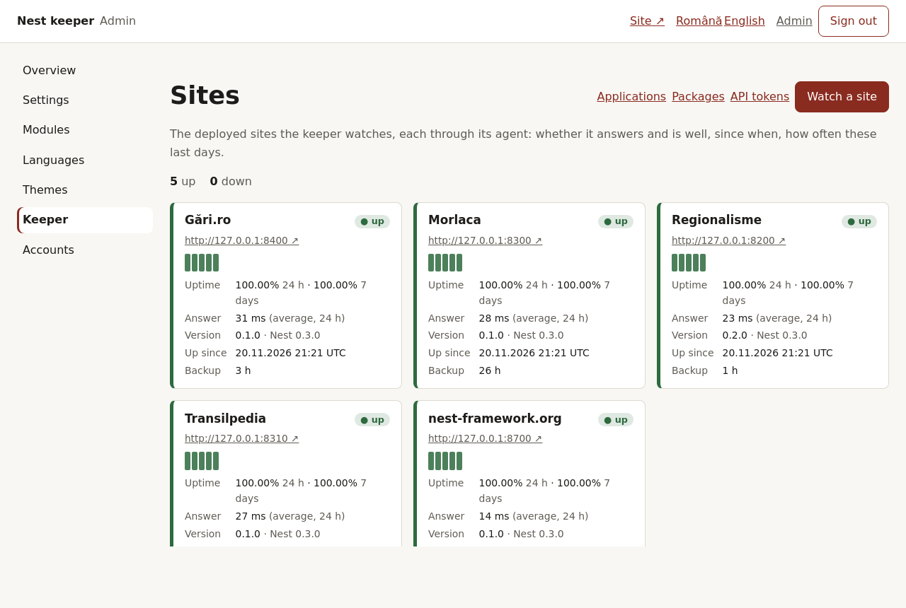

# Modules and applications

An application is a list of modules plus the choices that tie them together. This
page covers how to pick modules, mount and configure them, change them while the
site runs, and declare what a site in its own repository needs from Nest.

## Choosing modules

Start from what the site does, then add what those modules need. Nest pulls in
dependencies by itself, but listing a module lets you give it a route and settings.

| If the site needs | Use | It also needs |
|---|---|---|
| Accounts and sign-in | `auth` | `nest.db` |
| An admin panel | `admin` | `auth` |
| Pages, articles, categories, menus | `content` (at `/`) | `media`, `nest.db`, `nest.search`, `nest.storage` |
| Photo galleries and albums | `gallery` | `media`, `nest.db`, `nest.storage` |
| Maps with markers | `maps` | `nest.db` |
| A "near me" page | `geo` | modules that answer `geo.near` (maps) |
| Comments on anything | `comments` | `nest.db` |
| A forum, private messages | `forum`, `messages` | `auth`, `nest.db` |
| Search titles, sitemap, robots.txt | `seo` | `nest.db` |
| Old addresses kept working | `redirects` | `nest.db` |
| Text in several languages | `translations` | modules with translatable records |
| "Saved." messages after actions | `notifications` | nothing |

Each module's reference page lists its settings, dependencies and admin pages, for
example [the gallery module](/docs/reference/modules/gallery). The
[modules page](../modules.md) explains core and optional modules in depth.

## Mounting a module

```yaml
modules:
  - name: content
    route: /
  - name: gallery
    route: /galerii-foto
    config:
      upload_max_mb: 20
  - name: redirects
  - name: notifications
```

| Key | Meaning |
|---|---|
| `name` | The package's name, as `nest catalog` lists it |
| `route` | Where its pages are served. Choose any path; old sites often keep their old ones (a blog can stay at `/blog`). |
| `config` | Values for the module's settings, for this application |
| `core: true` | It can never be disabled or uninstalled; nor can what it depends on |
| `enabled: false` | Listed, but off until an administrator turns it on |
| `optional: true` | If its setup fails, the site starts without it instead of refusing to start |

Some modules need no route. `notifications` serves no pages. `redirects` and `seo`
keep all their editing pages in the admin panel (`seo` serves `/sitemap.xml` and
`/robots.txt` at the site's root by itself). The `content` module serves pages at
whole-site paths and must be mounted at `/`.

### What config is for

A value in `config` is the site's starting value for a setting. An administrator can
change it in the admin panel (it is then kept in the workspace), and an environment
variable `NEST_<APP>__<MODULE>__<KEY>` overrides both. Put in `config` what belongs
to the site and should travel with its code: its public address for `seo`, whether
guests may comment, whether registration is open.

```yaml
  - name: auth
    route: /cont
    config:
      allow_registration: false
  - name: comments
    route: /comentarii
    config:
      allow_guests: true    # guests' comments wait for a moderator
```

Secrets never go here. A module's secret (an old site's address key, a database
password) is set in the environment or the workspace's `.env`.

## Changing modules on a running site

The manifest is the code's; what an administrator chooses later is the site's, kept
in the workspace (`data/modules.yml`) and laid over the manifest. A deploy never
undoes it, and a backup keeps it.

```sh
uv run nest modules APP                                  # core, enabled, disabled, available
uv run nest modules APP disable gallery                  # its data stays
uv run nest modules APP enable gallery
uv run nest modules APP enable forum --route /forum      # one the manifest does not list
uv run nest modules APP uninstall comments --yes         # its data and settings go
```

The admin panel's **Modules** page does the same. Each change is planned first (you
cannot disable a module another enabled module needs), the workspace is backed up,
the application is made again with the new set of modules, and it is rolled back if
it cannot start. An uninstall also drops the module's tables and tells the other
modules to forget what they kept about it. Under `nest run`, a change made from the
command line needs a restart by hand; a change made in the panel applies in place.
The full sequence is on the [modules page](../modules.md).

## Installing packages

Enabling only works with packages that are installed. Installing is the server
administrator's job, from the packages the server trusts:

```sh
uv run nest packages APP                # in use, installed, available
uv run nest packages APP add forum      # into pyproject.toml and module.yml's deps, then uv sync
uv run nest packages APP remove forum   # refused while the application uses it
```

A package added this way arrives installed but not used. It then appears on the
Modules page, ready to add at a route.

## A site in its own repository

Nest's own applications live in `applications/`. A real site lives in a repository
of its own, beside the Nest checkout:

```text
~/projects/
  nest/          the framework
  mysite/        module.yml, pyproject.toml, locales/, tests/
  othersite/
```

### deps, by ecosystem

Such an application lists what it needs in `deps`, grouped by the ecosystem each
package belongs to, with a version range. From a magazine site's `module.yml`, shortened:

```yaml
deps:
  nest:
    content: ">=0.1,<1"
    gallery: ">=0.1,<1"
    admin: ">=0.1,<1"
    auth: ">=0.3,<1"
    base: ">=0.2,<1"
    paper: ">=0.1,<1"
    db: ">=0.2,<1"
    db-sqlite: ">=0.1,<1"
```

Once an application declares `deps`, the plan holds it to them. Every package it
uses (modules, theme, interfaces and providers) must be listed, under the right
ecosystem, at a version that is installed. Its own local modules need not be.

### pyproject.toml asks for the same

The application's `pyproject.toml` asks Python for the same versions, and tells uv
where Nest is:

```toml
[project]
name = "mysite"
requires-python = ">=3.12"
dependencies = [
    "nest-core>=0.2,<1",
    "nest-content>=0.1,<1",
    "nest-gallery>=0.1,<1",
    # ...
]

[tool.uv]
package = false  # an application folder, which Nest runs

[tool.uv.sources]
nest-core = { path = "../nest/packages/nest-core", editable = true }
nest-content = { path = "../nest/modules/content", editable = true }
```

Then, from the site's folder:

```sh
cd ~/projects/mysite
uv sync
uv run nest run .
```

### A test that keeps them in step

The sites carry `tests/test_contract.py`, which checks two things:

- every entry in `deps` names a package Nest can find, has a version range, and is
  under the ecosystem that package belongs to, and the application plans with them;
- `pyproject.toml` asks for exactly the versions `deps` gives, and nothing that
  `deps` does not list (apart from `nest-core`).

Copy it from an existing site into a new one. When you add a Nest
module later, add it to `deps` first, then to `pyproject.toml`, and the test tells
you if you forgot one.

## The keeper's view

The keeper (`applications/keeper`, port 8000) watches the deployed sites through their
agents, and its **Applications** page (`/admin/keeper/apps`) finds every application on
this machine: Nest's own in `applications/`, and the sites in the folders of its `apps`
setting (`../mysite`, ...). For each it shows the manifest, the plan (start
order, routes, bindings, notes), any problems, and whether it answers its health check.
Its **Packages** page per application installs and removes packages the same way
`nest packages` does.



See [The keeper](../operate/keeper.md).

## Checking an application

| Command | What it tells you |
|---|---|
| `nest plan APP` | Start order, routes, bindings, and what is missing |
| `nest modules APP` | Each module: core, enabled, disabled, available |
| `nest validate --strict modules` | Manifests, and that code uses other packages only by their published names |
| `nest check APP` | What running it in production needs |
