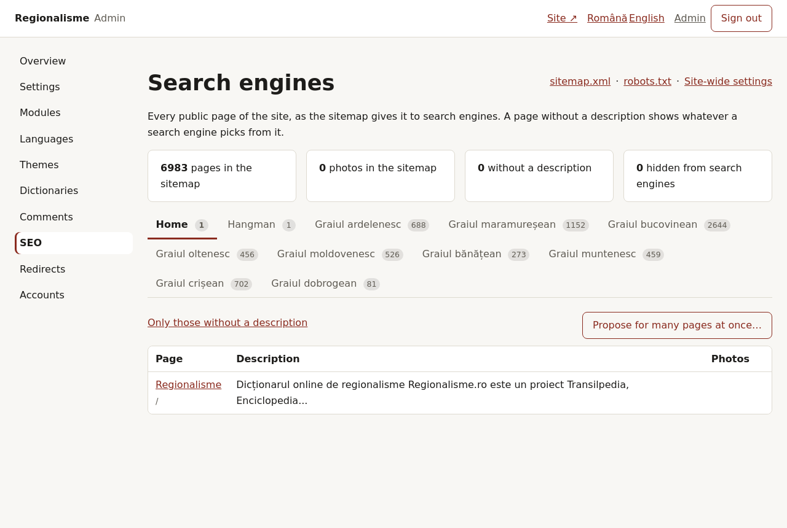

# Search and SEO

Three pieces decide how people find a site: its own search box, what search engines
are told about each page, and whether old links still lead somewhere. In Nest they
are an interface (`nest.search`) and two modules (`seo`, `redirects`).

## Site search

`nest.search` is an interface: modules index documents and ask for matches, and the
provider decides how. The application binds it:

```yaml
bind:
  nest.search:
    providers: [search-sqlite]
```

Modules that need it (`content`) say so in their manifest, and
`nest plan` reports it if the binding is missing.

### What a module does with it

A module indexes **documents**, each with a `kind` (whose it is), an `id`, a `title`,
a `body`, a `url`, and an optional `scope` that narrows a search (one entry type, one
category). It then asks for matches:

```python
from nest import bound
from nest_search import Document, Search

@router.get("/search")
def search(request: Request, q: str = "", index: Search = bound(Search)):
    hits = index.query(q, kind="content.entry", limit=20) if q else []
    ...
```

The interface also has `count`, `suggest` (titles starting with what was typed),
`remove` and `clear`. Results come back as hits with a snippet that is escaped first
and then marked, so a match can never inject HTML.

### search-sqlite

`search-sqlite` keeps an SQLite FTS5 index in the workspace:

- **Diacritics are folded both ways.** "stiinta" finds "știință", and "ştiinţă"
  (with the old cedilla letters) finds both spellings.
- **The last word typed matches as a prefix**, so results appear while typing.
- **Titles rank above bodies**, by BM25.
- **What people type is only words**, never query syntax.

| Setting | Default | Meaning |
|---|---|---|
| `path` | `data/search.db` | The index file, relative to the workspace |
| `title_weight` | 10.0 | How much more a match in a title counts than one in the body |

The index is derived data. If it is lost or a module changed how it indexes, rebuild
it from the records:

```sh
uv run nest content reindex APP
```

The content module's search page is at `/search`.

## SEO

`seo` tells search engines and shared links what each page is. It works for any page
of any module, without the modules depending on it.

```yaml
modules:
  - name: seo
    config:
      site_url: https://example.org
      description: "News, stories and photos from a small town."
```

It needs no route: its pages are `/sitemap.xml` and `/robots.txt` at the site's
root, and its editing pages are in the admin panel.

### Site-wide settings

| Setting | Meaning |
|---|---|
| `site_url` | The public address; canonical links, the sitemap and shared links are made with it. Empty takes the request's. |
| `title_pattern` | How a page's title appears in results and the browser tab; default `{title} · {site}` |
| `description` | What the site is, for pages that say nothing of their own |
| `keywords` | Words the whole site is about; a page adds its own |
| `image` | The picture a shared link shows when a page has none |
| `twitter` | The site's X (Twitter) account, as `@name` |
| `google_verification`, `bing_verification` | The codes Search Console and Bing Webmaster give to confirm the site is yours |
| `robots_closed` | Extra paths search engines are asked not to visit, comma-separated |

### Per page

For each page (a **subject**, such as `content.entry:12` or `gallery.collection:3`),
editors can set a search title, a description, keywords, a sharing picture, a
canonical address, and whether search engines may list it (noindex). These fields
appear in each module's own edit form, so an editor sets them where they write the
page. A **Propose** button fills them from the page's own text: the description from
its first sentences, the keywords from the words it uses most, names counting more.
Nothing is sent to an outside service.

The module writes the meta tags, Open Graph tags and JSON-LD structured data into each
page's head, so a page is read as an article, a photo gallery, or the site itself.

### The SEO page

**Admin → SEO** shows how every page appears in search results, a tab per kind of
page (articles, pages, categories, galleries, maps), with what is described and what
is missing.



For many pages at once there is a **batch**:

1. choose the pages (a tab, or all), which fields, and whether to fill only empty
   ones or all;
2. preview, page by page, what each field holds and what would be written;
3. apply to the pages you keep checked.

What the pages held before is kept in the workspace (`data/seo-batches/`), so the
last batch can be undone whole.

### Sitemap and robots.txt

`/sitemap.xml` lists every public page of every module, with its photos (Google's
image sitemap), leaving out pages marked noindex. Pages in other languages are listed
at their own addresses.

`/robots.txt` closes the admin panel and the sign-in pages, plus `robots_closed`, and
points to the sitemap. Outside production (`NEST_ENV` not `production`) it asks
search engines to stay away from the whole site, so a test copy is never indexed. An
application can write its own as `templates/seo/robots.txt`.

Without the `seo` module, the content module serves a simpler sitemap and robots.txt
for its own pages.

### How a module takes part: seo.urls and seo.text

A module joins in by answering two lookups:

- **`seo.urls`**: its public pages, each with a path, title, subject, description,
  text and photos. The sitemap and the SEO page are built from these answers.
  content, gallery, maps and docs answer it.
- **`seo.text`**: for a subject, extra words to propose from, for a page with little
  text of its own (a category's entries). content answers it.

Its edit form shows `{{ seo_fields(subject) }}`, its save asks the `seo.save` lookup,
and its pages call `{{ seo_head(subject, ...) }}` in their head. Without the seo
module these lookups have no answer and the page carries its own plain title. See
[Lookups](../develop/lookups.md).

## Redirects

`redirects` sends old addresses on to new ones, so links from other sites, bookmarks
and search results still work after a site moves to Nest.

```yaml
modules:
  - name: redirects
```

All its pages are in the admin panel (**Admin → Redirects**, for editors), so it
needs no route.

- **A page always wins.** Redirects answer only after every route and after the
  content module's stored pages (it is a fallback at priority -10). A redirect can
  never hide a page that exists.
- **Targets** are a path on this site or an http(s) address. A loop is refused when
  it is added. Statuses are 301 (default), 302, 307, 308, and 410 for a page gone for
  good.
- **Hit counts** show which old links are still used.
- **Moved pages are recorded by themselves.** When an editor changes a content
  entry's address, the content module asks the `redirects.moved` lookup, and the old
  address redirects to the new one.

From the command line:

```sh
uv run nest redirects add APP /old-page/ /new-page/
uv run nest redirects add APP /closed/ "" --status 410
uv run nest redirects import-csv APP old-links.csv     # source,target[,status] per line
uv run nest redirects list APP
```

### Whole folders and modules' own old addresses

A package can declare **prefix rules** in its manifest, sending a whole folder on
with the rest of the path kept:

```yaml
redirect_prefixes:
  "/wp-content/uploads/": "/media/uploads/"
```

A module that answers old addresses itself (an old site's `/index.php/...` addresses)
asks the `redirects.request` lookup for those it does not know, before it gives up on them.
