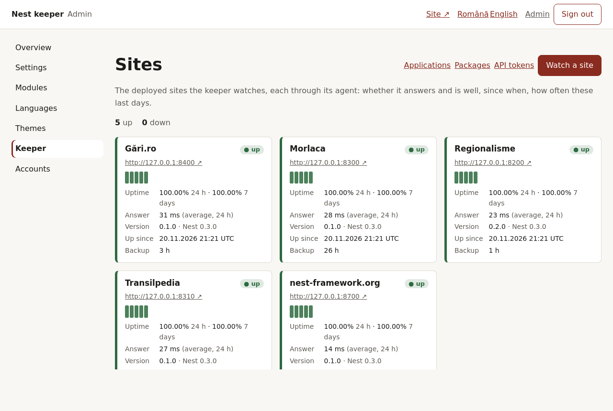
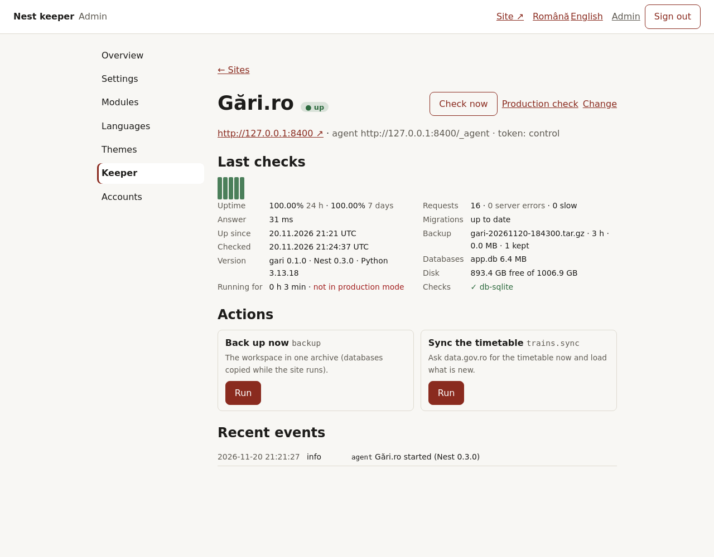

# The keeper

The keeper (`applications/keeper`) is Nest's own application. It does two jobs:

- **It watches the deployed sites.** Each site includes the [agent](#the-agent) module,
  and the keeper asks every agent how its site is doing: whether it is up and since when,
  its uptime over 24 hours and 7 days, how fast it answers, its versions, pending
  migrations, its last backup, recent warnings and errors. It can also ask a site to do
  something, such as make a backup or sync its timetable.
- **It shows every application Nest can see** on this machine: how each one is planned,
  what is wrong with it, and which packages it uses.

What is specific to one application (its content, its accounts, its settings) is in that
application's own [admin panel](../guide/admin-panel.md), not in the keeper.



## Running it

```sh
cd ~/projects/nest
uv run nest run applications/keeper     # http://127.0.0.1:8000 → /admin/keeper/
```

The keeper runs on port 8000. Its home page redirects to its admin panel, and every page
requires an account with the **admin** role. On a fresh workspace, create one first:

```sh
uv run nest auth create-user applications/keeper you@example.org --role admin --password-stdin
```

The application is small: the `keeper` module at `/`, `admin` at `/admin`, `auth` at
`/cont`, and SQLite for its own database. That database holds the watched sites, their
check history, the log of actions run, and its API tokens.

## Watching deployed sites

The keeper's first page, **Sites**, has a card for each watched site. A site is *up* when
its agent answers with its status, and *needs care* when it answers but reports a problem:
a pending migration, a module that failed to start, or a failed provider check (its
database, for example). It is *down* when it does not answer. The page refreshes every 15
seconds.

Each card shows:

- a bar for each of the last checks: green if the site answered well, amber if it was slow,
  red if it failed;
- uptime over 24 hours and 7 days, and the average answer time;
- the site's version and the Nest version it runs on;
- since when it has been up (or down), and how old its last backup is.

A site's own page adds:

- what is in its last status: how long it has been running, requests, server errors and
  slow answers, migrations, backups, database sizes, free disk space, provider checks;
- its recent events: warnings and errors from its log, its starts, actions run;
- **Production check**: `nest check`, run by the site itself;
- **Actions**: what its agent allows, and a log of who ran which action and what came of it.



### Services that are not Nest sites

**Watch a site** offers two ways:

- **through its agent**: a Nest site, or any service that answers
  [the agent's status format](agent-status.md). It gets the full card;
- **as a web address**: any service at all, such as a RoboHub instance. The keeper asks the
  address as a reader would, with no token and no redirect followed, and counts any answer
  below 400 as up. You get up or down, since when, uptime and answer time.

### Watching a site, step by step

1. Include the agent in the site's `module.yml` (the four sites and the documentation site
   already do):

   ```yaml
   deps:
     nest:
       agent: ">=0.1,<1"
   modules:
     - name: agent
       route: /_agent
   ```

   Add `nest-agent` to the site's `pyproject.toml` too.

2. Make the tokens, on any machine with Nest:

   ```sh
   nest agent token gari              # a token that reads
   nest agent token gari --control    # a token that also runs actions
   ```

   Each prints a token (`na_…`) for the keeper, and a line for the site:

   ```text
   NEST_GARI__AGENT__READ_TOKEN=sha256:3f1c…
   ```

3. Put that line in the site's environment (`/etc/nest/gari.env` on the server, the
   workspace's `.env` locally), then restart the site (`sudo nest-site restart gari`).
   The site keeps only the SHA-256 of the token.

4. In the keeper, click **Watch a site** and enter the site's name, its address
   (`https://gari.ro`) and the token. The agent's address defaults to the site's address
   followed by `/_agent`. The keeper checks the site at once, then every `check_seconds` (5 minutes).

To let the keeper run actions, give it the control token instead (on the site's
**Change** page). With the read token alone, the actions are listed but cannot be run.

### Settings

| Setting | Default | Meaning |
|---|---|---|
| `check_seconds` | 300 | how often each site is checked, in seconds (every 5 minutes; 60 at least). With the scheduler, its job `keeper.watch` does it |
| `history_days` | 30 | how many days of checks are kept for the uptime figures |

### Security

- The keeper keeps each agent token encrypted with a key derived from its
  `NEST_SECRET_KEY`, so a copy of its database does not reveal the tokens. If that key
  changes, the keeper asks for the tokens again.
- It calls agents only over https, except on this machine (`127.0.0.1`, `localhost`).
  It never follows a redirect, so a token is never sent to another address.
- A site keeps only the SHA-256 of its tokens, and compares them in constant time. An
  address that keeps sending bad tokens gets 429 for a minute.
- Every action is logged in the keeper with the account that ran it, and in the site's
  events.

## Restarts and upgrades: the host helper

A site runs in a container, and neither the site nor the keeper (another container) can
restart it. `nest-host` (in `deploy/site/`) is a small service on the server that does it
for them: it runs `nest-site` when the keeper asks with its token.

Give a watched site its **name on the server** (its `nest-site` name, `gari`) on its
**Change** page, and set the keeper's `host_url` and `host_token`. The site's page then has
a **Server** section:

- its systemd unit (`nest-site@gari.service`) active or not, healthy or not, and when its
  current and previous images were built;
- **Restart** and **Back up**, one click each;
- **Upgrade**, **Roll back**, **Stop** and **Start**, each behind a confirmation;
- each job's output while it runs (the page follows it every 2 seconds), and its log.

An upgrade is `nest-site upgrade`: it pulls the sources, builds, backs up, restarts (the
migrations run first), and rolls back by itself if the site is not healthy.

The helper is deliberately narrow:

- it runs only `nest-site` and only these actions: `restart`, `start`, `stop`, `backup`,
  `upgrade`, `rollback`. `ALLOW` in its `host.conf` can narrow the list further. No shell
  is used, and the only things taken from a request are the site's name and the action;
- the site must have `/etc/nest/<site>.conf`, and its name must be lowercase letters,
  digits and dashes. `SITES` in `host.conf` can narrow which sites it serves;
- it listens on the loopback or a private address only (the Docker bridge), and refuses
  to start on a public one;
- it keeps only the SHA-256 of its token (`nh_…`, from `nest-host token`). It answers 429
  to an address that keeps sending bad tokens;
- it runs one job at a time per site, and stops a job after 30 minutes;
- it writes every job, with the account that asked, to `/var/lib/nest-site/host-jobs.log`
  and the journal. The keeper notes it in the site's action log too (`server.restart`, …).

Installing it is in [Deploying on a server with ISPConfig](../deploy-ispconfig.md).

| Setting | Default | Meaning |
|---|---|---|
| `host_url` | empty | the helper's address: `http://127.0.0.1:8090`, or `http://172.17.0.1:8090` from a container. Plain http only to the loopback or a private network |
| `host_token` | (secret) | the helper's token, in the keeper's environment: `NEST_KEEPER__KEEPER__HOST_TOKEN=nh_…` |

## The agent

The `agent` module is a small API on each site, at the route the site gives it (`/_agent`).
Every call carries `Authorization: Bearer na_…`. Cookies are never read, so a signed-in
browser cannot be made to call it.

| Call | Token | Answer |
|---|---|---|
| `GET /_agent/v1/status` | read | name, title and version; Nest and Python versions; production mode; when it started and its uptime; requests, server errors and slow answers; provider checks; modules and their state; pending migrations; backups; database sizes; free disk space |
| `GET /_agent/v1/events?after=N` | read | its recent warnings and errors, its starts, the actions run (the last `events`, 200 by default) |
| `GET /_agent/v1/check` | read | what production needs, as `nest check` reports it |
| `GET /_agent/v1/actions` | read | the actions it allows, and whether this token may run them |
| `POST /_agent/v1/actions/{name}` | control | run one; 409 if it is already running |

Its own action is **backup**: the workspace in one archive, made while the site runs, the
oldest removed beyond `backup_keep` (7). A module adds actions by answering
`agent.actions` with a list of `nest_agent.Action`. The trains module offers
**trains.sync**, which fetches the timetable from data.gov.ro now:

```python
from nest_agent import Action

def setup(host):
    if host.has_module("agent"):
        actions = [Action("trains.sync", "Sync the timetable", run_sync, "Fetch it now.")]
        host.answer("agent.actions", lambda _key: actions)
```

`run` takes the application's `Nest` object and returns short text or a dict. It runs in
a thread, one run at a time per action.

> [!NOTE]
> Requests and events are counted in memory, by each worker process, since it started.
> A site with several workers answers from whichever worker takes the call. The keeper
> keeps the history.

## How it finds applications

It looks in two places:

1. **Installed packages of type `application`.** Any site installed into Nest's
   environment as a package.
2. **The folders in its `apps` setting**, comma-separated and relative to where Nest runs.
   A folder can hold applications (one per subfolder with a `module.yml`), or it can *be* an
   application, as each site's repository is.

The keeper application sets:

```yaml
modules:
  - name: keeper
    route: /
    config: {apps: "applications,../voievodate,../gari,../morlaca,../regionalisme,../transilpedia"}
```

That covers Nest's own applications (`applications/`: the keeper, hello, the registry and
the documentation site) and the sites in their own repositories beside Nest. An application listed in two
places is shown once. A folder whose manifest cannot be read still appears, with the error
as its problem.

## What it shows

### Applications

**Applications** (`/admin/keeper/apps`) lists every application on this machine, with:

| Column | Meaning |
|---|---|
| name and title | from its manifest |
| version | `module.version` |
| port | `application.port` |
| packages | how many units its plan contains |
| runs | `● runs` when `http://127.0.0.1:<port>/healthz` answers 200 within 0.3 s, `○ stopped` when it does not, `—` with no port |
| problems | how many problems it has |

**Problems** are what the contract check (`nest validate`) finds in the manifest, plus any
planning error (a missing dependency, a version that does not fit, a binding with no
provider). These are the same messages `nest plan` would print.

### One application

An application's page shows its plan, as `nest plan APP` computes it: each unit in start
order with its type, version and route; the bindings (interface → providers); the plan's
notes; and the problems. The running check is repeated for that application.

### An application's packages

From an application's page, **Packages** shows what Nest's registry offers that
application, grouped as *used*, *installed* (asked for directly but not used),
*with* (installed as a dependency of another package) and *available*. The page can
install or remove a package. This does what `nest packages APP add|remove` does: it edits the
application's `pyproject.toml` and its `deps:` in `module.yml`, then runs `uv sync`. If a step
fails, both files are restored. A package installed this way arrives *installed, not used*,
ready to be enabled in the application's admin panel (Modules).
See [Modules](../modules.md).

A search box on the same page queries the Nest registry
([registry.nest-framework.org](../registry.md)) for packages that work with this
nest-core, and installs from it (the registry's address is `nest login`'s, or
`NEST_REGISTRY_URL`).

This page only manages an application that has a `pyproject.toml` of its own.

### Packages

**Packages** lists every package Nest can see, grouped by type (application, module,
theme, provider, interface…), with the catalogue's own problems.

### API tokens

The keeper has a read-only REST API at `<route>/api/v1`, for another orchestrator:

| Call | Answer |
|---|---|
| `GET /api/v1/` | what is here, and the token's name and scopes |
| `GET /api/v1/ecosystem` | Nest itself: name, kind, version, the package types it knows |
| `GET /api/v1/apps` | every application: version, port, whether it runs, its problems |
| `GET /api/v1/apps/{name}` | one application: its plan (units in start order, routes, bindings, notes) and problems |
| `GET /api/v1/packages` | every package Nest can see, by type |

Every call carries `Authorization: Bearer nk_…`. Tokens are made on the keeper's
**Tokens** page or from the command line:

```sh
nest keeper token applications/keeper NAME    # printed once
nest keeper tokens applications/keeper        # the list (never the secrets)
nest keeper revoke applications/keeper ID
```

A token is shown once, stored only as a SHA-256 hash, and can be revoked. Its only scope is
`read`. The API never reads cookies, so a signed-in browser cannot be made to call it. An
address that keeps sending bad tokens gets 429 for a while, and answers are marked not to
be cached.

> [!NOTE]
> These are the keeper's own API tokens. Tokens for publishing to or installing from the
> Nest registry are made on the registry's Tokens page and kept with `nest login`; see
> [The registry](../registry.md).

## Run your own keeper

A keeper is one person's tool. It holds the tokens of the sites it watches, and with
control tokens and the host helper it can restart and upgrade them. So there is no shared
keeper to sign up to: you run your own, on a domain of yours, and your tokens never leave
your server.

It is an ordinary Nest application, deployed like any site with `nest-site`. The kit is in
`applications/keeper/deploy/`:

| File | What it is |
|---|---|
| `DEPLOY.md` | the steps below, in full |
| `Dockerfile` | its image, built from Nest's repository |
| `site.conf.example` | `/etc/nest/keeper.conf`: port 8800, data in `/srv/nest/keeper` |
| `keeper.env.example` | `/etc/nest/keeper.env`: its secret, its domain, the host helper |
| `nginx.conf` | the ISPConfig nginx directives, with optional `allow` lines for your own addresses |

In short:

```sh
sudo install -m 0640 /opt/nest/src/nest/applications/keeper/deploy/site.conf.example /etc/nest/keeper.conf
sudo nest-site init keeper && sudo editor /etc/nest/keeper.env
sudo nest-site build keeper
sudo systemctl enable --now nest-site@keeper nest-site-backup@keeper.timer
sudo nest-site nest keeper auth create-user /src/nest/applications/keeper you@example.org --role admin --password-stdin
```

> [!IMPORTANT]
> Make your account before the domain points at the keeper. Registration is off, but the
> first account of a fresh keeper may always be made, since it becomes the administrator.

Then turn on the domain in ISPConfig with `nginx.conf`, sign in, and watch your sites. The
keeper reaches them at their public addresses. With the host helper bound to the Docker
bridge (`BIND=172.17.0.1`), its container reaches the host at
`http://172.17.0.1:8090`.

## In production

The **Sites** dashboard is made for production. Run the keeper on any machine that can reach
the sites over https, such as the server itself behind nginx, and watch them there.

The **Applications** and **Packages** pages read application folders from this machine's
disk, and check whether each application runs on `127.0.0.1:<port>`. On a server where each
site runs in its own container, built from `/opt/nest/src/<site>` with a host port from
`/etc/nest/<site>.conf`, those pages are a development and planning tool. Packages are
installed in development, committed and built, never changed in a running container.

Restarting and upgrading a container is done on the host, by `nest-site` and systemd,
either from the keeper (through the [host helper](#restarts-and-upgrades-the-host-helper))
or by hand:

| Question | On the server |
|---|---|
| Is it running? | the keeper's Sites page; `sudo nest-site status S` |
| Its log | `sudo nest-site logs S` (the keeper shows its warnings and errors) |
| Is it ready for production? | the keeper's Production check; `sudo nest-site nest S check /src/app` |
| A backup now | the keeper's **backup** action; `sudo nest-site backup S` |
| A restart | the keeper's **Restart**; `sudo nest-site restart S` |
| A new version | the keeper's **Upgrade**; `sudo nest-site upgrade S` |
| Restore, roll back | see [Backups and upgrades](backups-and-upgrades.md) |
