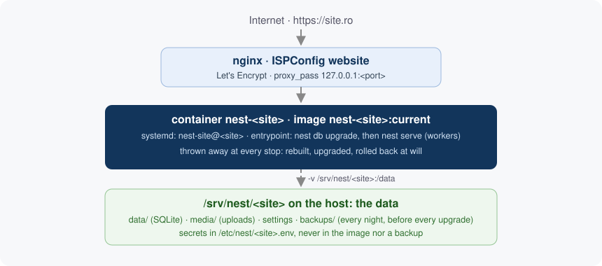

# Running Nest sites

A Nest application runs the same way on a laptop and on a server. Only its environment and
its workspace change. This page covers what changes between the two, which settings
production reads, and where to go next for each kind of deployment.

## Two servers: `nest run` and `nest serve`

| | `nest run APP` | `nest serve APP` |
|---|---|---|
| Meant for | development | production |
| Processes | one (uvicorn), `--reload` restarts it when files change | gunicorn's master and its workers, each an asyncio server with a pool of threads |
| Default address | `127.0.0.1`, the application's `port` | `$NEST_HOST`, else `127.0.0.1`; `$PORT`, else the application's port |
| Migrations | applied by themselves at start (`NEST_MIGRATE=auto`, the development default) | applied by the master once, before it forks, unless production refuses (see below) |
| Workers | `--workers` (1 by default; keep 1 with SQLite) | `serve: workers` in `module.yml`, `NEST_WORKERS`, or `--workers` (`auto` = the CPUs) |

```sh
uv run nest run .                  # http://127.0.0.1:<port>/, one process
uv run nest run . --reload         # restarts on every change
uv run nest serve . --dry-run      # the plan and gunicorn's settings, nothing started
uv run nest serve . --workers 4 --threads 8
```

`nest serve` is the gunicorn model a Flask developer knows. The master makes the
application once and runs its checks, so a broken application never forks. Then each worker
makes its own copy. gunicorn replaces a worker that dies or stays silent past `timeout`,
renews each one after `max_requests`, reloads them one by one on `kill -HUP <master>`, and
stops them gracefully on SIGTERM. [Deploying](../deploy.md) covers the `serve:` section and
what the workers share.

### Production mode and migrations

`NEST_ENV=production` switches the application to production. It then:

- requires `NEST_SECRET_KEY` and refuses to start without it;
- sends secure cookies and HSTS, and closes the API docs;
- **never migrates on its own.** Without `NEST_MIGRATE`, production means `check`: the
  application refuses to start while any module has a pending migration.

`NEST_MIGRATE` takes three values: `auto` (upgrade every module at start, the development
default), `check` (refuse to start behind, the production default) and `off` (neither).
`nest serve` sets `off` for its workers after the master has dealt with migrations, so the
workers never race each other at it.

In production, migrations run in exactly one place: the container image's entrypoint
(`deploy/entrypoint.sh`). It runs `nest db upgrade /src/app` and then `nest serve`. A site
upgraded with `nest-site upgrade` is backed up before that restart (see
[Backups and upgrades](backups-and-upgrades.md)). By hand:

```sh
nest db status APP        # what is applied and what is pending, per module
nest db upgrade APP       # apply the pending migrations
```

## The environment

Secrets and per-server values come from the environment or the workspace's `.env`, never
from `module.yml`. On a server, a site's secrets are in the `.env` of its data folder
(readable by the site's user only), and its service passes the other production settings
(`-e NEST_ALLOWED_HOSTS=…`).

| Variable | What it does |
|---|---|
| `NEST_ENV` | `production` on a server (the image sets it) |
| `NEST_SECRET_KEY` | 32 characters or more; signs sessions and forms. Required in production. `nest-site init` writes a fresh one |
| `NEST_ALLOWED_HOSTS` | the host names the site answers, comma-separated (`example.org,www.example.org`). Any other host gets 400 |
| `NEST_TRUSTED_PROXIES` | the proxies whose `X-Forwarded-*` headers are believed. `*` only when the port is reachable from the proxy alone (bound to `127.0.0.1`, as `nest-site` does) |
| `NEST_WORKERS` | processes for `nest serve`; each uses about 85 MB |
| `NEST_THREADS` | each worker's threads for synchronous handlers |
| `NEST_TIMEOUT`, `NEST_MAX_REQUESTS` | seconds before a silent worker is replaced; requests before a worker is renewed |
| `NEST_LOG_LEVEL` | `debug`, `info`, `warning`, `error` |
| `NEST_HOST`, `PORT` | where `nest serve` listens |
| `NEST_APP_WORKSPACE` | the workspace folder (default `~/.local/share/nest/<app>/`; `/data` in the image) |
| `NEST_MIGRATE` | `auto`, `check` or `off` (above) |
| `NEST_MAX_BODY_MB` | the largest request body, in MB (default: `application.max_body_mb`, 32) |

The order of precedence for `nest serve` is the application's `serve:` section, then the
environment, then the command line. The later one wins.

The sites' `.env` examples use these values:

```ini
NEST_TRUSTED_PROXIES=*
NEST_WORKERS=2
NEST_THREADS=8
NEST_LOG_LEVEL=info
```

### Module settings from the environment

Every module setting can be set from the environment as `NEST_<APP>__<MODULE>__<KEY>`:
the names are in capitals, and any character other than a letter or digit becomes `_`.
For example:

```ini
NEST_MYSITE__COMMENTS__ALLOW_GUESTS=false   # comments.allow_guests for the application mysite
NEST_MYSITE__FORUM__POSTS_PER_MINUTE=3
```

Secret settings (the agent module's `read_token`, a provider's password) belong here or
in the workspace `.env`, and never in a committed file.

A binding can be switched the same way, with `NEST_BIND__<INTERFACE>` (dots become
underscores):

```ini
NEST_BIND__NEST_DB=db-postgres
NEST_BIND__NEST_STORAGE=storage-s3
```

They go in the data folder's `.env` when a site moves to a database and file server.

## Is it ready? `nest check`

```sh
nest check APP
```

`nest check` lists what production needs, each item marked ok (`✓`), a warning (`!`) or a
failure (`✗`). It exits 1 on any failure. It checks:

- `NEST_ENV=production`, and `NEST_SECRET_KEY` (32+ characters);
- `NEST_ALLOWED_HOSTS` (a warning when empty: it would answer any host);
- with the content module, an `https://` `content.site_url` (otherwise the sitemap and
  shared links take each request's address);
- a writable workspace and at least 2 GB free beside it;
- each SQLite database's journal mode (WAL expected) and integrity (`PRAGMA quick_check`);
- databases on a server, reminding you to back them up with their own tools;
- with the auth module, at least one active administrator;
- the last backup, and whether it is more than two days old.

On a `nest-site` server: `sudo nest-site nest <site> check /src/app`.

## SQLite or PostgreSQL

Every site built with Nest so far binds `nest.db` to `db-sqlite`, which is the right default
for content sites: a magazine, a blog, a village site or a photo archive is read far
more than it is written. SQLite runs in WAL mode, `nest backup` copies it online while the
site runs, and it needs no server. With several workers, SQLite reads well from all of them
(each worker lets one thread at a time into it).

Move to PostgreSQL (`db-postgres`; `db-mariadb` exists too) when many visitors **write** at
once, for example a game. It is the same application with a different binding: set
`NEST_BIND__NEST_DB=db-postgres` and its URL in the environment, then move the data with
`nest backup` and the database's own import. Keep in mind that `nest backup` does not
include a database on a server. Back it up with `pg_dump` or `mariadb-dump`.

## A shared cache and live updates with several workers

One worker needs nothing more. With several, bind the `redis` provider (Redis or Valkey):

```yaml
bind:
  nest.cache: {providers: [redis]}
  nest.pubsub: {providers: [redis]}
```

The connection URL goes in the environment (`NEST_<APP>__REDIS__URL`), never in the
manifest.

- **`nest.cache`**: `cache-memory` keeps values inside each worker. `redis` shares them
  across every worker and machine. Sign-in limits are counted in the shared cache when there
  is one, otherwise in the database.
- **`nest.pubsub`**: live updates (a forum post, a message over SSE) reach visitors on every
  worker. Without it, an event reaches only the visitors of the worker that made it.

`nest serve` prints a note at start when several workers run without these.

## Deploying



**One image per site, data on the host.** Each site has an image built from its repository and Nest
(`deploy/site/nest-images`), on Docker Hub. systemd runs it (`nest-<site>.service`), bound
to `127.0.0.1:<port>`, behind the server's nginx. Its workspace is a folder on the host,
`/var/snap/docker/common/nest/<site>`, mounted at `/data`, and the container runs as that folder's owner. A
restart, a new image or a crash never touches the data. Read
[the ISPConfig guide](../deploy-ispconfig.md) for the full procedure, and
[Deploying](../deploy.md) for the image, its environment and `nest serve`.

**The registry** (registry.nest-framework.org) is its own image, run the same way. See
[Running the registry](../registry-deploy.md).

Each site repository has a `deploy/` folder:

| File | Purpose |
|---|---|
| `DEPLOY.md` | that site's own commands, step by step |
| `nest-<site>.service` | the systemd service: its image from Docker Hub, its port, its data folder `/var/snap/docker/common/nest/<site>` mounted at `/data` |
| `nginx.conf` | the directives for the ISPConfig website: the proxy, upload size, unbuffered live updates |

> [!TIP]
> Run `nest check` once the site is up, set up the nightly backup, and copy the
> backups off the server. [Backups and upgrades](backups-and-upgrades.md) explains how.

## Where next

- [Backups and upgrades](backups-and-upgrades.md): `nest backup`, `nest restore`,
  `nest-site upgrade` and its automatic rollback.
- [The keeper](keeper.md): watching the deployed sites through their agents (uptime, versions, events, backups), a copy of their backups on its server, restarts, upgrades and restores on each server, and every application at once.
