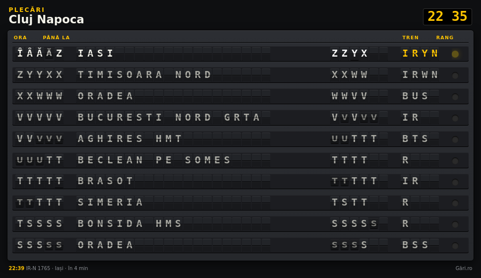
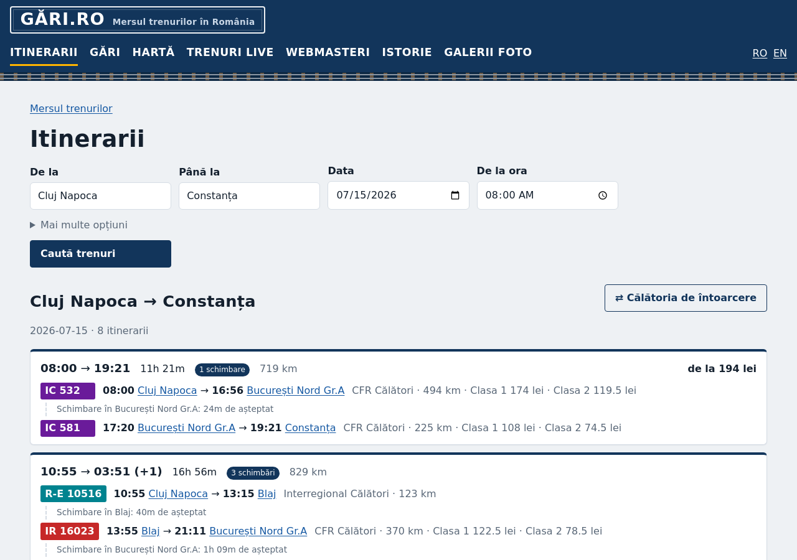
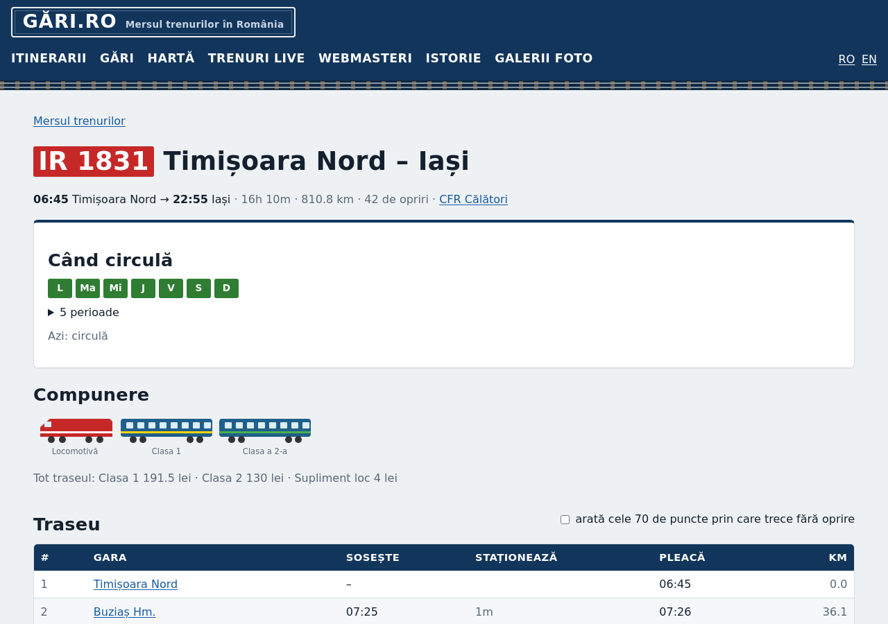

# Gări

> **Version 0.1.0** of the site (its repository's `module.yml`), on Nest %NEST_VERSION%.

[gari.ro](https://www.gari.ro) is the Romanian train timetable. It was moved from an old
Geticus (CodeIgniter) site and now runs as a Nest application. The timetable comes from
Romania's open-data portal, and the site updates itself when a new one appears. Its
pages: journeys with changes, every station with its departures and arrivals, every train
with its route, running days and composition, split-flap boards other sites embed, the
trains running now on a map, and stations near the reader. The site also kept its history
articles and photo galleries.



| | |
|---|---|
| Repository | `gari` (beside `nest`) |
| Port | 8400 |
| Theme | `rail-signage`: an enamel-blue header, a rail line, departure-board amber |
| Languages | Romanian at `/`, English at `/en/` |
| Main module | [`trains`](/docs/reference/modules/trains) at `/cfr` |
| Other modules | content `/`, gallery `/galerii-foto`, maps `/harti`, geo `/in-apropiere`, comments `/comentarii`, [`scheduler`](/docs/reference/modules/scheduler) (the timetable's sync), [`agent`](/docs/reference/modules/agent) `/_agent`, admin, auth, media, redirects, notifications, seo |

The generic work lives in Nest's `trains` module, so another country's timetable could use
it. The `gari` repository contains only the application: its `module.yml`, its words and
its tests.

## The timetable from data.gov.ro

Informatică Feroviară publishes the timetable on data.gov.ro, a CKAN portal: one dataset per
operator ("Mers tren - Regio Calatori", …), one XML file per timetable year, named after its
period ("… 2025-2026"). The new year appears every December, before the timetable changes on
the second Sunday of the month.

The `trains` module reads it in three steps:

| File | Role |
|---|---|
| `sources/datagov.py` | asks the portal's API which files exist, and picks for each operator the year running now and the next one. Downloads a file, refusing anything over 64 MB or not XML, and computes its checksum |
| `sources/cfr_xml.py` | reads the CFR XML (`XmlMts`, schema `trnIfSchema_v4`) into plain data: trains, their route segments (stop type, dwell, distance), their calendars (`Zile` weekday bits and date ranges) and their `Servicii` code |
| `loader.py` | writes one file into the database: into the timetable of its period (created by the first file of that year), stations created from their codes, and that file's trains replacing what it brought before |

Loading the December file, or a corrected file, leaves other operators' trains alone. Station
places and services, which the files do not carry, are kept.

```sh
uv run nest trains sync .            # the files from data.gov.ro, when new or changed
uv run nest trains sync . --force    # load every file again
uv run nest trains sources .         # what was loaded, from where, when
uv run nest trains load-xml . FILE   # one CFR XML file by hand
```

`sync` keeps the downloaded files in the workspace (`data/trains-sources/`). A file with the
same date and checksum is skipped, so a daily run costs one request to the portal.

### Following it by itself

```yaml
modules:
  - name: trains
    route: /cfr
    config:
      sync: true
```

With the `sync` setting on, the [scheduler](../develop/scheduling.md)'s job `trains.sync`
asks the portal **every 6 hours** and loads only what changed. A check that finds nothing new
costs one small request. This is how the new year arrives in December and becomes the
timetable in force on its first day. **Admin → Scheduler** shows each run and its result,
and **Run now** syncs at once.

To change how often, add to gari's `module.yml`:

```yaml
schedule:
  - {job: trains.sync, every: 3h}
```

In production the environment can turn it off: `NEST_GARI__TRAINS__SYNC=false`. An
application without the scheduler gets the module's own loop instead, every `sync_hours`
(24).

Other settings: `sync_portal` (another CKAN portal), `sync_query` (what to search for,
`mersul trenurilor`), `transfer_minutes` (5) and `max_transfers` (3) for the planner.

### From the old site

The old site's own data came across once, from its MySQL dump:

```sh
uv run nest trains import-geticus-stations . gari.sql   # station places, services, galleries
uv run nest trains import-geticus-fares . gari.sql      # the fare table
uv run nest content import-geticus . gari.sql --root ../gari-legacy/gari
uv run nest gallery import-geticus . gari.sql --root ../gari-legacy/gari
```

## Journeys



`/cfr/itinerariu` plans journeys from one station to another on a given day. The search is
the site's home page (`site_home: true`), as it was on gari.ro.

The planner (`planner.py`) uses the **Connection Scan Algorithm**. For the travel date,
every train that runs that day according to its calendar is cut into connections, one per
pair of consecutive passenger stops. Trains from the day before that are still running after
midnight are included, and so are the next day's, so a journey can continue overnight. The
connections are sorted by departure and kept in memory for the day: a few tens of thousands,
built in a fraction of a second. A search scans them once from the requested hour. A
connection either continues a train already boarded, or is boarded at a station reached at
least `transfer_minutes` earlier. Several searches from successive departures give the day's
choices. A choice that leaves earlier, arrives later *and* changes more often than another
is dropped. A search takes milliseconds.

The form offers:

| Field | Parameter | |
|---|---|---|
| From, To | `de`, `la` | names matched without diacritics ("Bucuresti" finds "București Nord") |
| Date | `data` | any day of the timetable |
| From the hour | `ora` | the next 12 journeys from then; without it, the whole day |
| Through | `via` | journeys passing through that station |
| Changes at most | `schimbari` | up to `max_transfers` |
| Direct trains only | `directe=1` | no changes |

A name that matches no station gets "Did you mean" suggestions. Results offer later journeys
and the return journey. **Calendars** are applied exactly: a train runs on a day when one of
its running rules allows that weekday in that period and no "not running" rule removes it.

## Stations and trains

**A station** (`/cfr/gara/<slug>`) shows its departures or arrivals (all trains of the
timetable, or only today's), what it offers (ticket office, left luggage, waiting rooms,
help for reduced mobility…), its place on a map, its photo gallery when it has one, and a
link to its board.

**A train** (`/cfr/tren/<number>`) shows:

- its route: every passenger stop with arrival, departure and dwell time, with the
  points it runs through counted separately;
- **when it runs**: the weekdays and the periods its calendar names, and whether it runs
  today (or on the chosen day), or "every day of the timetable";
- **its composition, drawn** as SVG: locomotive or railcar, then 1st and 2nd class,
  restaurant, couchette, sleeping car and bicycle cars, read from the file's `Servicii` code
  (an editor can correct it);
- the fares the fare table gives per class for the whole route;
- **its route on a map** (`/cfr/tren/<number>/harta.geojson`) through the maps module.



**Replacement buses.** CFR files list a road service that replaces a train during works with
the train's number prefixed by `Auto` (`Auto3075`). Such a train is drawn as a bus and
labelled as a replacement bus. Asking for `/cfr/tren/3075` when only `Auto3075` runs that day
redirects to the bus.

Other pages: `/cfr/gari` (stations A to Z), `/cfr/companii` and `/cfr/companie/<slug>`
(operators), and `/cfr/harta` (the railway map drawn from the timetable).

## Boards for other sites

`/cfr/gara/<slug>/tabela` is a board of the next trains at a station, as a page of its own
with no site frame:

| Parameter | Values |
|---|---|
| `tip` | `plecari` (departures, the default) or `sosiri` (arrivals) |
| `randuri` | rows, 3 to 20 (10 by default) |
| `stil` | `flap` (split-flap board, the default), `led` (an amber LED panel), `classic` (the blue enamel station board) |

Its script fetches the trains again every minute and flips the letters that changed. The
clock shows Romanian time. Today's trains are followed by tomorrow's when the day runs out.
The same data is available as JSON at `/cfr/gara/<slug>/tabela.json`, served with
`Access-Control-Allow-Origin: *`.

**Only these pages can be framed.** Nest sends `X-Frame-Options: DENY` and a strict
Content-Security-Policy on every page. The board marks its own response as embeddable, and
every other page keeps the strict policy.

**The Webmasters page** (`/cfr/webmasteri`) builds the embed code: choose a station,
departures or arrivals, rows, look and width, see a live preview, and copy an `<iframe>`.
It also offers a journey search box (a plain form opening `/cfr/itinerariu`) to paste on
another site.

## Trains running now

`/cfr/trenuri-live` shows every train running at this moment on a map that refreshes every
30 seconds. gari.ro has no live position feed, so positions come **from the timetable**:
a train that runs today (or set out yesterday and is still running), between its first
departure and its last arrival, is placed at a station while it stands there, otherwise
between the two points it is travelling between, as far along as the elapsed time says.
Each dot links to the train's page.

## Stations near me

- `/cfr/localizare` asks the browser for the reader's location (only this page may) and lists
  the nearest stations with their distances.
- The `geo` module's page (`/in-apropiere`) shows what every module has nearby. `trains`
  contributes the railway stations within 50 km by answering the `geo.near` lookup.

## Places checked against the tracks

gari.ro's station coordinates were geocoded by name long ago, and some are wrong (a halt
placed 40 km off its line). `places.py` checks them against the timetable: the timetable
gives the distance along the tracks between each train's stops, and two neighbours much
further apart as the crow flies than along the tracks disagree. A station far from where its
agreeing neighbours place it is marked misplaced. The worst are set aside first, one round at
a time, because one misplaced station makes its neighbours look wrong too. Misplaced stations,
and stations with no place at all, are then estimated on their line between well-placed
neighbours.

```sh
uv run nest trains check-places .    # "N misplaced stations found, M places estimated"
```

A place set by an editor in the admin panel is never changed.

## Old gari.ro addresses

With `legacy_addresses: true`, the old site's addresses are redirected permanently (301):

| Old address | Goes to |
|---|---|
| `/cfr/gara/<token>`, `/cfr/tren/<token>` | the station or train page |
| `/mersultrenurilor/gara/plecari/<token>` | the station's board |
| `/mersultrenurilor/tren/<token>` | the train |
| `/tren/cfr1734`, `/statie/<code>` | the train, the station |
| `/eurail/…` | the station list (the European stations are gone) |

The old site encrypted numbers in its addresses (CodeIgniter's Encrypt class). With the old
site's key, a token decodes back to a station's CFR code or a train's number. The key is the
`trains.legacy_key` setting, a secret: it is set only in the workspace `.env` as
`NEST_GARI__TRAINS__LEGACY_KEY`, never in the repository. Without it, a token cannot be
read, and its address goes to the timetable's home or the station list instead.

## The admin panel: Timetable

Admin → **Timetable** (role editor) shows:

- the timetable in force, every timetable loaded and its number of trains, the source files,
  and the operators;
- how many stations have a place, and whether `sync` is on;
- a button to check data.gov.ro now (optionally reloading everything);
- **Stations**: search by name or code, or list those with no place. A station's form edits
  its name, place, services, telephone, gallery and whether it is shown;
- **Trains**: whether a train is shown, its composition (a list of car types) and a source
  link.

## Deployment

Gări deploys like every Nest site (see [the ISPConfig guide](../deploy-ispconfig.md)):
`/etc/nest/gari.conf` sets port 8400 and a 1 GB memory limit, its data lives in
`/srv/nest/gari`, and `deploy/nginx.conf` lets uploads and live updates through.
