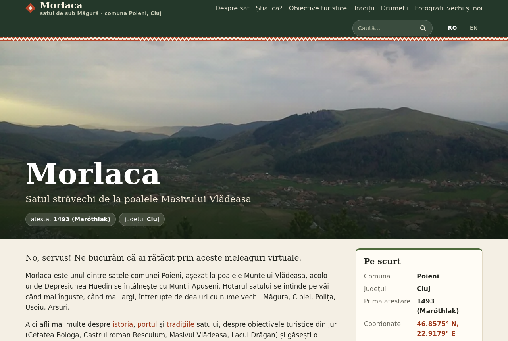

# Morlaca

> **Version 0.1.0** of the site (its repository's `module.yml`), on Nest %NEST_VERSION%.

[morlaca.ro](https://morlaca.ro) is a village's site. It presents Morlaca, a village at the
foot of the Vlădeasa massif in Poieni commune, Cluj county: its facts, its history, the
sights around it, a map of its places, its traditions and old photographs. It was a
WordPress site. Its posts, comments and galleries moved to Nest and kept their old
addresses.



| | |
|---|---|
| Repository | `morlaca` (beside `nest`) |
| Port | 8300 |
| Theme | `morlaca-valley`; `morlaca-heritage` and `morlaca-chronicle` can be chosen in Admin → Themes |
| Languages | Romanian at `/`, English at `/en/` |
| Modules | [`content`](/docs/reference/modules/content) at `/` (home: the village's page), [`gallery`](/docs/reference/modules/gallery) at `/galerii`, [`maps`](/docs/reference/modules/maps) at `/harta`, [`comments`](/docs/reference/modules/comments) at `/comentarii`, [`translations`](/docs/reference/modules/translations), [`agent`](/docs/reference/modules/agent) `/_agent`, seo, redirects, media, admin, auth, notifications |

`content`, `admin`, `auth` and `media` are marked `core: true`: the site cannot run without
them, so they can never be disabled or uninstalled. The others are managed in the admin
panel (see [Modules](../modules.md)).

## Moving from WordPress

Each WordPress feature is imported by the Nest module that replaces it. Every importer reads
the site's `mysqldump`, and can run again: matching by the WordPress ids it keeps, it updates
what it brought in the first time. A site can be moved, checked, and moved again.

```sh
L=~/projects/morlaca-legacy
uv run nest content import-wordpress . $L/db/morlaca.sql --uploads $L/wp-content/uploads
uv run nest comments import-wordpress . $L/db/morlaca.sql
uv run nest gallery import-wordpress . $L/db/morlaca.sql --uploads $L/wp-content/uploads --all
uv run nest maps import-wordpress . $L/db/morlaca.sql
uv run python tools/seed_settlement.py --uploads $L/wp-content/uploads
```

| Importer | What comes across |
|---|---|
| `content import-wordpress` | categories and tags (with their parents), posts and pages (published, draft, private) with their slugs, each post's categories and featured image, the attachments with their files and every resized copy, the menus, the front page. Bodies get WordPress's paragraphs once, links to the old site become relative, upload addresses become `/media/uploads/…`, and everything is sanitized. `--prefix` for tables other than `wp_` |
| `comments import-wordpress` | the comments, attached to the posts they belong to |
| `gallery import-wordpress` | Photo Gallery and NextGEN galleries, their old shortcodes kept. `--all` brings every gallery, not only those a page uses |
| `maps import-wordpress` | WP Google Maps maps and markers (`[wpgmza id="1"]` keeps working) |
| `tools/seed_settlement.py` | the village's own page, from `site/settlement.html`, made the home page |

**Addresses.** Posts keep WordPress's `/%category%/%postname%/` addresses (the `post`
type's path is `/{category}/{slug}/`), so every old link still works. Pictures linked from
elsewhere at their WordPress addresses are redirected by the manifest:

```yaml
redirect_prefixes:
  /wp-content/uploads/: /media/uploads/
```

`nest gallery tidy .` counts photo descriptions that are only file names and captions that
are only camera data. With `--apply`, it clears them.

## Content types

```yaml
content_types:
  post:
    path: "/{category}/{slug}/"
    taxonomies: [category, post_tag]
    fields:
      lat: {type: decimal, label: Latitudine}
      lng: {type: decimal, label: Longitudine}
  settlement:
    path: "/{slug}/"
    fields: {tagline, county, commune, altitude, population, population_year,
             first_record, postal_code, lat, lng, distances, access}
```

(The `settlement` fields are abbreviated here; each has a type and a label in the manifest.)

- **The village's page** is a `settlement` entry at `/morlaca/`, made the home page with the
  content module's `home: /morlaca/`. Its facts are shown when filled in. Edit them in
  Admin → Content → Localitate, or in `site/settlement.html` followed by the seed script
  again.
- **A post with latitude and longitude** is a place on the map. The maps module's page
  (`/harta/`) shows the main map (`main: morlaca`) with every place any module offers: the
  content module offers each published entry whose type has `lat` and `lng` fields.

## The three themes

The three `morlaca-*` themes ship with Nest (`themes/`). They are generic: what is Morlaca's
own is not in their templates but in **theme settings**, which is why Transilpedia and
Regionalisme use the same themes with their own texts. See [Themes](../themes.md).

| Theme | Look |
|---|---|
| `morlaca-valley` | the valley's greens and the roofs' terracotta, a cross-stitch band under the header, the village's page as the home page, a search box, breadcrumbs and what to read next |
| `morlaca-heritage` | as the site looked for years: the village's name over the panorama, the menu under it, a sidebar with the search, the categories and the newest articles |
| `morlaca-chronicle` | the village's almanac: a large serif masthead, the menu in small capitals between rules, warm paper, articles set like a book with drop capitals and large photographs |

Heritage and chronicle extend valley, so they share its settings and add only their own
`tagline`. Morlaca's settings, in `module.yml`:

```yaml
application:
  theme: morlaca-valley
  theme_settings:
    morlaca-valley:
      tagline: "the village below the Măgura · Poieni commune, Cluj"
      about: "An old village at the foot of the Vlădeasa massif, ..."
      banner: uploads/2017/12/cropped-panorama_morlacii-1.jpg
      links: "Map of the places = module:maps; Old and new photographs = module:gallery; ..."
      invite_title: "Do you have memories of Morlaca?"
      invite_text: "The village's old photographs and stories belong here. ..."
      credit: morlaca.ro
      home_featured: obiective-turistice
      home_lists: "tradiii, stiai-ca"
      home_album: fotografii-vechi-si-noi
    morlaca-heritage:
      tagline: "The village at the foot of the Vlădeasa mountains"
    morlaca-chronicle:
      tagline: "the almanac of the village below the Măgura"
```

| Setting | Meaning |
|---|---|
| `tagline` | under the site's name |
| `about` | a sentence in the footer about the place |
| `banner` | a stored picture (`uploads/…`) over every inner page; empty for none |
| `menu` | the top menu as `Label = target; …`, replacing the content module's menu; empty to use that menu |
| `links` | the footer's links, same syntax (`module:maps`, `category:<slug>`, an address) |
| `invite_title`, `invite_text` | a footer invitation to send memories and photographs |
| `credit` | after "© <site>" at the foot of every page |
| `home_featured` | the category whose newest articles the home page shows as cards |
| `home_lists` | categories the home page lists side by side |
| `home_album` | the gallery module's album the home page shows |

The texts are written in English and translated by the site's `locales/ro.json`, like every
word of the site. An administrator switches themes in Admin → Themes: the switch is tried
first, kept in the workspace, and can be previewed before anyone else sees it.

## Two languages

```yaml
application:
  languages: [ro, en]
  admin_languages: [ro, en]
  browser_language: false
  language_urls: prefix
```

Romanian is the default, at `/`. English pages are at `/en/…`, one address per language for
search engines and caches. The site stays in Romanian until a visitor chooses English; the
browser's language is not used to guess. The interface words come from the modules' and the
site's locales.

Content is translated with the `translations` module. Each entry's edit form shows its
fields in every language but the default one, and Admin → Translations lists what is
missing, a draft or outdated (the Romanian changed after the translation was made). Texts
can also be exported for translators and imported back:

```sh
uv run nest translations status .
uv run nest translations export . en.json --lang en          # missing, outdated and drafts
uv run nest translations import . en.json
```

A page not yet translated is shown in Romanian. See [Languages](../languages.md).

## Galleries

The gallery module (`/galerii`) holds galleries of ordered photos, and albums of galleries.
Each has its own page. They can be embedded in any page with `[gallery slug="…"]` or
`[album slug="…"]`, and WordPress's old gallery shortcodes keep working. Thumbnails open in a
lightbox, and without JavaScript they are plain links. Editors create galleries and albums in
the admin panel, upload photos (checked by their bytes, with location metadata removed), order
them, describe them and move galleries between albums. The home page shows the
`fotografii-vechi-si-noi` album (`home_album`). See
[Content and media](../guide/content-and-media.md).

## Comments

Guests can comment under any article (`allow_guests: true`). Their comments wait for a
moderator. The old WordPress comments came across with `comments import-wordpress`.

## Deployment

Like every Nest site ([the ISPConfig guide](../deploy-ispconfig.md)): port 8300, a 768 MB
memory limit, data in `/srv/nest/morlaca`. Requests may carry up to 25 MB
(`max_body_mb: 25`); the nginx directives allow 30 MB, so the application's own limit
is the one that answers.
