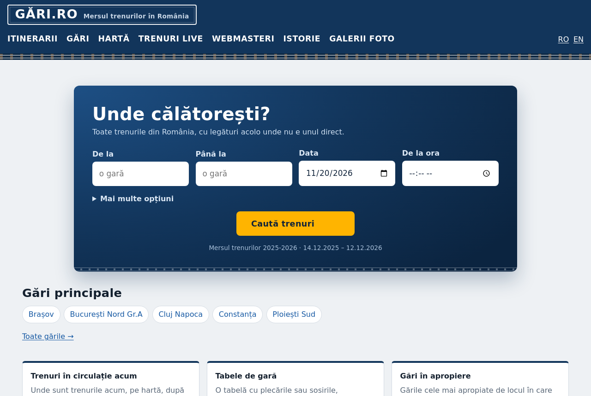
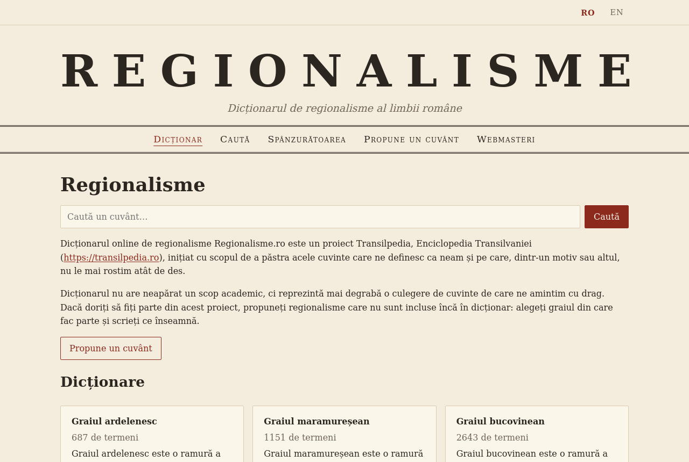
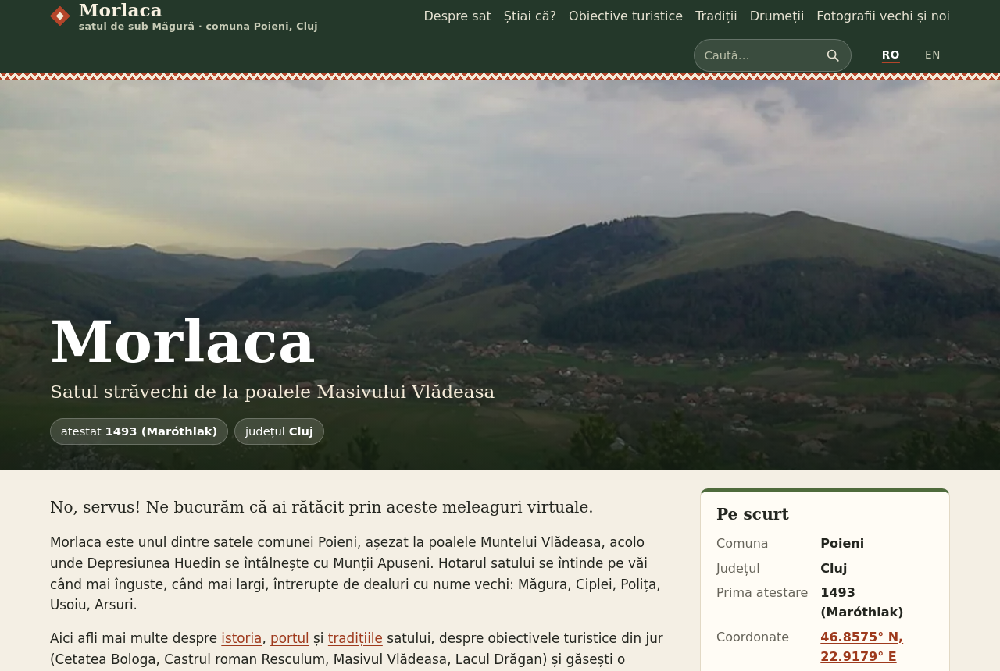
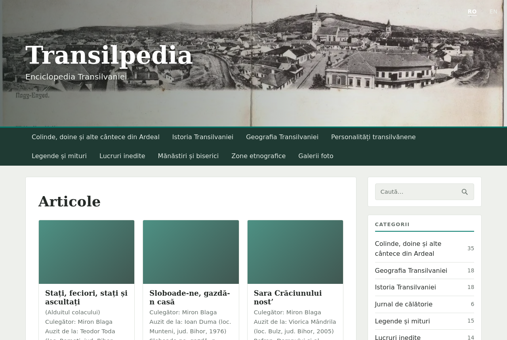

# Sites built with Nest

Nest was written alongside the sites it runs. Each site is an application in a repository
of its own, beside a Nest checkout: a `module.yml` (the modules it mounts, its settings, its
port and its contract with Nest), a `pyproject.toml` asking for the same Nest packages,
its own `locales/`, tests, and a `deploy/` folder. Everything generic (modules, themes, the
host) lives in Nest. The site repository holds only what makes that site itself.

| Site | What it is | Modules | Theme | Port |
|---|---|---|---|---|
| [Gări](gari.md) (gari.ro) | The Romanian train timetable from data.gov.ro: journeys with changes, station boards, train pages, a live map | trains, content, gallery, maps, geo, comments, seo, redirects, media, admin, auth, notifications | `rail-signage` | 8400 |
| [Regionalisme](regionalisme.md) (regionalisme.ro) | A dictionary of Romanian regional words: nine dictionaries, proposals, comments, hangman | glossary, comments, hangman, seo, redirects, admin, auth, notifications | `morlaca-chronicle` | 8200 |
| [Morlaca](morlaca.md) (morlaca.ro) | A village's site: its page, articles, old photographs, a map of its places | content, gallery, maps, comments, translations, seo, redirects, media, admin, auth, notifications | `morlaca-valley` | 8300 |
| [Transilpedia](transilpedia.md) (transilpedia.ro) | The encyclopedia of Transylvania: articles, galleries, an English version | content, gallery, comments, translations, seo, redirects, media, admin, auth, notifications | `morlaca-heritage` | 8310 |

All four bind `nest.db` to SQLite and `nest.search` to `search-sqlite`. The three with
uploads also bind `nest.storage` to `storage-local`. All run in Romanian at `/` and English at
`/en/`.

## What each one demonstrates

### Gări: a module with real data and real traffic



- **A domain module.** `trains` is a module like any other: tables and migrations, CLI
  commands, admin pages, lookups it answers (`geo.near`, `seo.urls`, `seo.text`). It could
  serve another country's timetable.
- **Data that maintains itself.** A background task (`@host.background(single=True)`, one
  worker at a time) checks data.gov.ro daily and loads new timetable files, including next
  year's in December.
- **Algorithms in a request.** Journeys with changes are planned with the Connection Scan
  Algorithm over the day's connections, kept in memory, in milliseconds.
- **Selective framing.** Station boards can be embedded on other sites. Only those pages
  relax the default `X-Frame-Options: DENY` policy.
- **Modules that cooperate without importing each other.** The `geo` module's "near me" page
  shows stations because `trains` answers its lookup. Station galleries come from `gallery`.

### Regionalisme: community features with moderation



- **An import from another engine.** Glossword's MySQL dump comes in with one command, and
  its comments with another, re-runnable. Old `/index.php/…` addresses redirect.
- **Visitors contributing safely.** Proposals pass through a honeypot, a signed time stamp
  and a per-address hourly limit, then wait for an editor. Guests' comments wait for a
  moderator.
- **A reusable game.** `hangman` knows nothing about dictionaries. It asks for a
  `words.random` lookup, which the glossary answers.
- **Translating text but not data.** In English, the definitions are explained and the
  words stay as they are.

### Morlaca: a WordPress site moved whole



- **Importers.** Posts, pages, menus, comments, galleries and the map's markers come from
  the WordPress dump, and every old address keeps working.
- **Custom content types.** The village's page is a `settlement` entry with its own fields
  (altitude, population, distances). A post with coordinates becomes a place on the map.
- **One theme for several sites.** The three `morlaca-*` themes take their texts (tagline,
  banner, footer links, home page sections) from theme settings, so Transilpedia and
  Regionalisme use them too.

### Transilpedia: the same modules, another site



- **Same modules, same admin panel.** Transilpedia is made of nearly the same modules as
  Morlaca. No admin panel was written for either; both get the one their modules provide.
- **Two languages.** English pages, with their own slugs, are written in Admin →
  Translations or exported and imported with `nest translations`.

## What every site repository looks like

The four repositories share one layout:

```
module.yml          the application: modules and routes, settings, theme and theme_settings,
                    languages, port, bindings, and deps (its contract with Nest)
pyproject.toml      Nest's packages at the same versions, installed from ../nest
locales/            ro.json and en.json: its own words (tagline, menu, footer)
tests/              test_contract.py keeps module.yml and pyproject.toml in step
deploy/             DEPLOY.md, nest-<site>.service, <site>.env.example, nginx.conf
```

**The contract.** `deps:` lists every Nest package the site uses, by ecosystem, each with
a version range:

```yaml
deps:
  nest:
    glossary: ">=0.1,<1"
    comments: ">=0.1,<1"
    db-sqlite: ">=0.1,<1"
```

Nest refuses to run a site when a package is missing, has another version, is listed under
the wrong ecosystem, or is used without being listed. A site that takes on a new Nest
module adds it here first. See [The manifest](../develop/manifest.md).

**Its own words, not its own templates.** None of the four overrides a theme's templates.
What is theirs (a tagline, a menu, footer links, a notice) is a theme setting written in
English in `module.yml`, and `locales/` translates it like every other word of the site.

## How they run

Each site runs as described in [Running Nest sites](../operate/overview.md): one container
per site, built from the site's repository and Nest, run by systemd as
`nest-site@<site>`, behind nginx, with its data in `/srv/nest/<site>` on the host. The
ports in the table are bound to `127.0.0.1` only. Each repository's `deploy/DEPLOY.md` has
that site's own commands.

During development, each one runs from its own folder:

```sh
cd ~/projects/gari
uv sync
uv run nest run .          # http://127.0.0.1:8400/
uv run pytest
```

[The keeper](../operate/keeper.md) sees all four at once. In development, its `apps`
setting lists their folders beside Nest. Deployed, each site includes the `agent` module
at `/_agent`, and the keeper watches it there: uptime, versions, migrations, backups and
recent errors.

A fifth application, Voievodate, is a game on Nest's Saga engine in a repository of its
own. The server guide reserves port 8500 for it.
