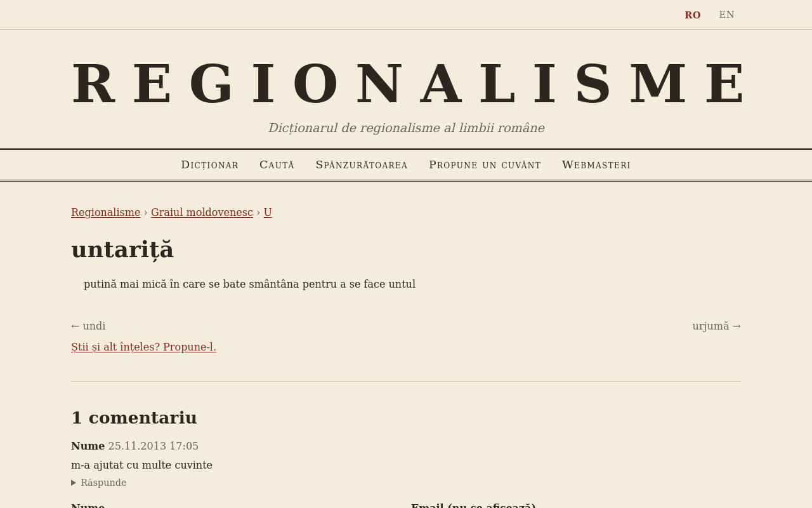
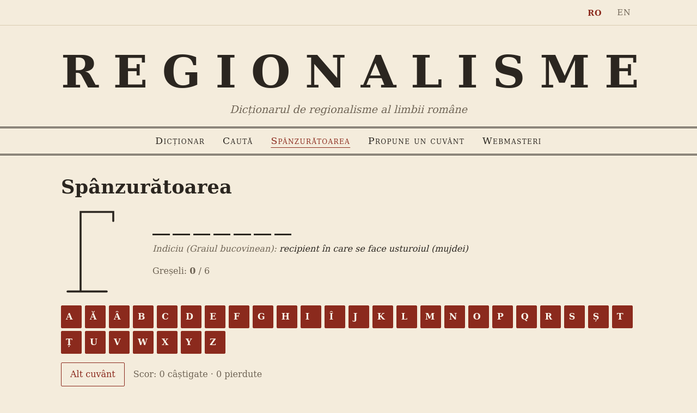
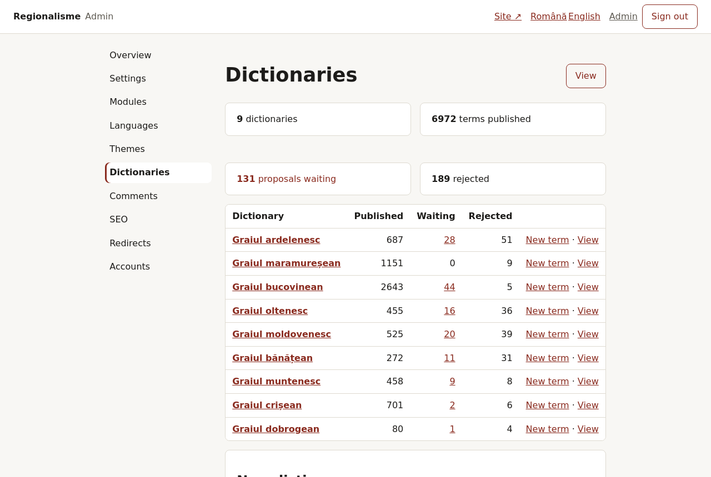
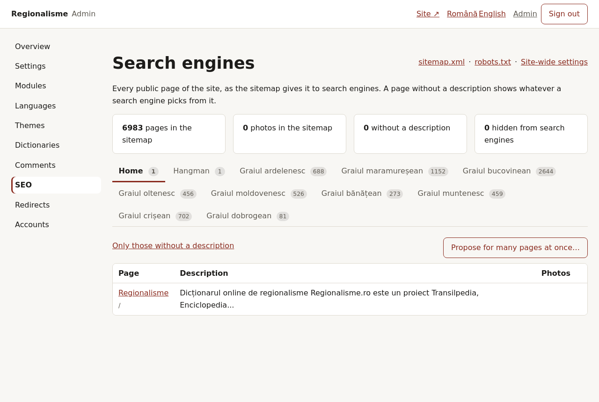

# Regionalisme

> **Version 0.2.0** of the site (its repository's `module.yml`), on Nest %NEST_VERSION%.

[regionalisme.ro](https://regionalisme.ro) is a dictionary of Romanian regional words: nine
dictionaries, one per dialect (Graiul ardelenesc, bănățean, …), searched together. It was
moved from Glossword, a PHP dictionary engine. Visitors propose words and meanings, which an
editor approves. They comment on terms (guests' comments wait for a moderator) and play
hangman with the dictionary's words. In English, at `/en/`, the definitions are explained
and the words stay as they are.



| | |
|---|---|
| Repository | `regionalisme` (beside `nest`) |
| Port | 8200 |
| Theme | `morlaca-chronicle` (a page of text, as a dictionary is); valley and heritage can be chosen in Admin → Themes |
| Languages | Romanian at `/`, English at `/en/` |
| Modules | [`glossary`](/docs/reference/modules/glossary) at `/`, [`comments`](/docs/reference/modules/comments) at `/comentarii`, [`hangman`](/docs/reference/modules/hangman) at `/spanzuratoare`, [`agent`](/docs/reference/modules/agent) `/_agent`, admin, auth, redirects, notifications, seo |

```yaml
modules:
  - name: glossary
    route: /
    config:
      legacy_glossword: true   # the old /index.php/... addresses redirect
      proposals: true          # visitors propose words and meanings
      webmasters: true         # /webmasters: search boxes for other sites
```

## The glossary module

A dictionary holds terms. A term has one or more senses, in the shape Glossword used:
definition, usage, synonyms, antonyms, see-also, source, translation and abbreviation. Pages:
the home page (an introduction, from the `intro` setting, over the dictionaries), a
dictionary's A to Z index by letter, a term's page with its neighbours, and a search across
every dictionary with diacritics folded both ways. A definition is plain text: a blank line
starts a paragraph, `[[word]]` links a term, and an address becomes a link. Nothing is
stored as HTML.

## Importing Glossword

The site's data were imported once from the old site's MySQL dump:

```sh
uv run nest backup .
uv run nest glossary import-glossword-db . ../regionalisme-legacy/db/regionalisme.sql
uv run nest comments import-glossword . ../regionalisme-legacy/db/regionalisme.sql
uv run nest glossary dictionaries .
```

- `glossary import-glossword-db` brings every dictionary of a Glossword site, with its
  terms and senses, and reports the published, pending and rejected count for each. The
  tables' prefix (`reg_`, `gw_`) is detected automatically, or given with `--prefix`.
  Each dictionary keeps its Glossword name, so old addresses can be found again.
- `comments import-glossword` brings the comments (GentleSource Comment Script) and
  attaches each to wherever its term went. The comments module does not know about the
  glossary: it asks the `glossary.legacy_subject` lookup which subject an old address
  became, and skips comments whose term did not come across. Approved stays approved;
  what the old spam filter held back becomes spam. Run it after the terms.

Both imports can run again: they update what they brought in before.

Other ways in and out: `glossary import-glossword` (a Glossword text export, into one
dictionary), `glossary export` and `glossary import` (Nest's own JSON of every dictionary),
`glossary add-dictionary`, and `glossary reindex` (rebuild the search index).

### Old addresses

With `legacy_glossword: true`, Glossword's addresses redirect permanently: `/index.php`
goes to the home page, its searches (`?a=srch&q=…`) to the new search, and
`/index.php/term/<Dictionary>,<word>.xhtml` to the term (or its dictionary when the word is
gone). The old site's own pages were added with the redirects module:

```sh
uv run nest redirects add . /index.php/viewpage/Spânzurătoare.xhtml /spanzuratoare/
```

## Proposals

`/propose` lets any visitor send a word with its definition, an example of use, a source,
and optionally a name and email. The dictionary is chosen from a list. Before anything is
saved, the form is checked against robots and floods:

- a honeypot field that people cannot see and robots fill in;
- a signed time stamp: a form sent back sooner than `proposals_min_seconds` (3) after it was
  shown, or more than a day later, is refused;
- at most `proposals_per_hour` (5) proposals per address per hour. The address is kept only
  as a hash.

A proposal is saved as a **pending** term. Admin → Dictionaries → **Proposals** lists them
(pending, or rejected). An editor approves, rejects or deletes each one. When approved, a
proposal is published; a meaning proposed for a word already in the dictionary joins it as
another sense. A rejected proposal stays out of sight.

## Comments on terms

Every term page has the comments module's thread. With `allow_guests: true`, visitors
comment without an account and their comments wait for a moderator. See
[Community](../guide/community.md).

## Hangman



`/spanzuratoare/` is the [hangman module](/docs/reference/modules/hangman): guess a word
letter by letter before the drawing is finished. Hangman knows nothing about dictionaries:
its words come from whichever module answers the `words.random` lookup. The glossary
answers with a published word, its first meaning as the clue, and its page shown at the
end. The game is kept in a signed cookie, so there is no table and nothing to clean up, and
the word is never sent to the browser before the game ends.

| Setting | Default | |
|---|---|---|
| `alphabet` | `A Ă Â B C … Ș T Ț U V W X Y Z` | the letters offered; any other character of a word is shown from the start |
| `max_wrong` | 6 | wrong guesses before the game is lost |
| `min_letters`, `max_letters` | 4, 12 | the word lengths given |
| `show_clue` | true | show the meaning as a clue |

## English: definitions translated, words not

The site is bilingual (`language_urls: prefix`, `browser_language: false`): Romanian at
`/`, English at `/en/`, and Romanian until a visitor chooses English. In English, the
interface and each sense's definition and usage are in English; **the words themselves stay
Romanian**, because they are the dictionary's subject. A term not yet explained in English
is shown in Romanian, and the page says so.

Translators work on files:

```sh
uv run nest glossary export-texts . en en.json             # the definitions to explain
uv run nest glossary export-texts . en en.json --missing   # only those not translated yet
uv run nest glossary import-texts . en.json                # once translated
```

The export contains every published sense's definition and usage (the words included, for
context only), plus each dictionary's title and description. On import, a sense whose
definition changed since the export is skipped, since its translation would explain
something else. Editors can also write the English directly: the term editor shows each
sense's explanation in the other languages. See [Languages](../languages.md).

## Webmasters

`/webmasters` (the `webmasters` setting) offers two search boxes for other sites to copy:
one with the list of dictionaries and one small box. Each is a plain HTML form that sends
`q` (and `d`, a dictionary) to the site's search. Visitors to the other site search
regionalisme.ro, as the old site's Webmasteri page allowed.

## The admin panel: Dictionaries



Admin → **Dictionaries** (role editor):

- an overview: each dictionary with its published, waiting and rejected terms, and a form
  for a new dictionary;
- each dictionary: its title and description in every language, its position, and its terms
  found by the start of the word or by letter, filtered by status or by what is not yet
  translated. Each term can be edited, published, sent back or deleted;
- a term editor: every sense, with its explanation in the other languages;
- **Proposals**, described above.

Every save is indexed for search.

## Search engines

The seo module (`site_url: https://regionalisme.ro`) builds the sitemap from what each module
lists, the glossary's terms included. For search titles, descriptions and keywords, the
glossary answers the `seo.text` lookup with a term's meanings, a dictionary's description and
words, or the home page's introduction. Admin → SEO → **batch** uses this to propose the
fields for many pages at once: choose the pages and fields (only empty ones, or all),
preview what would be written page by page, apply the checked ones, and undo the last batch
as a whole if needed. See [Search and SEO](../guide/search-and-seo.md).



## Deployment

Like every Nest site (see [the ISPConfig guide](../deploy-ispconfig.md)): port 8200, a
512 MB memory limit, data in `/srv/nest/regionalisme`. Its `deploy/DEPLOY.md` moves the
data with `nest backup` in development and `nest-site restore` on the server.
