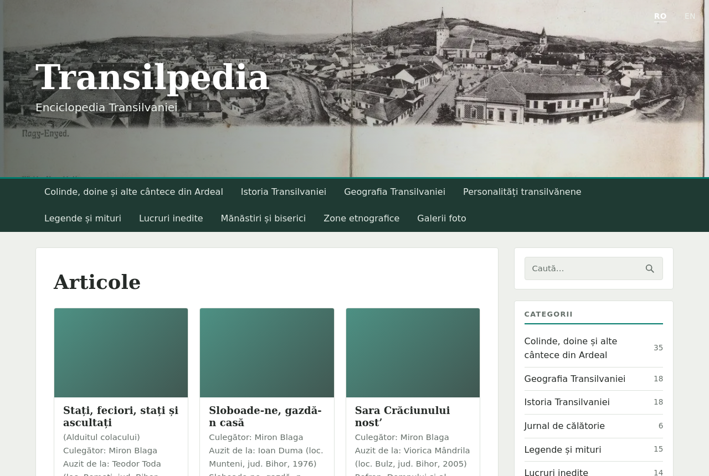

# Transilpedia

> **Version 0.1.0** of the site (its repository's `module.yml`), on Nest %NEST_VERSION%.

[transilpedia.ro](https://transilpedia.ro) is the encyclopedia of Transylvania: its history,
geography, legends, people, churches and songs. The site has a long history. It started on
Joomla, moved to WordPress, and now runs on Nest, with its posts, pages, comments and photo
galleries at their old addresses. It is also the parent project of
[Regionalisme](regionalisme.md).



| | |
|---|---|
| Repository | `transilpedia` (beside `nest`) |
| Port | 8310 |
| Theme | `morlaca-heritage`; `morlaca-valley` and `morlaca-chronicle` can be chosen in Admin → Themes |
| Languages | Romanian at `/`, English at `/en/` (translated slugs) |
| Modules | [`content`](/docs/reference/modules/content) at `/`, [`gallery`](/docs/reference/modules/gallery) at `/galerii-foto`, [`comments`](/docs/reference/modules/comments) at `/comentarii`, [`translations`](/docs/reference/modules/translations), [`agent`](/docs/reference/modules/agent) `/_agent`, seo, redirects, media, admin, auth, notifications |

Transilpedia is made of nearly the same modules as [Morlaca](morlaca.md) (everything but
the map). No admin panel was written for either site: both get the panel their modules
provide.

## Moving the old site in

The legacy site is a WordPress installation (kept in `../transilpedia-legacy`), so it uses
the same importers as Morlaca, reading the WordPress `mysqldump`:

```sh
L=~/projects/transilpedia-legacy
uv run nest content import-wordpress . $L/db/transilpedia.sql --uploads $L/wp-content/uploads
uv run nest comments import-wordpress . $L/db/transilpedia.sql
uv run nest gallery import-wordpress . $L/db/transilpedia.sql --uploads $L/wp-content/uploads
```

| Importer | What it brings |
|---|---|
| `content import-wordpress` | categories and tags, posts and pages (published, draft, private) with their slugs, featured images, attachments with their files and every resized copy, menus, the front page. Links to the old site become relative and upload addresses become `/media/uploads/…`. Everything is sanitized |
| `comments import-wordpress` | the comments, under their posts |
| `gallery import-wordpress` | Photo Gallery and NextGEN galleries, their shortcodes kept working |

Each importer can run again: it matches what it brought before by the WordPress ids it keeps,
and updates it. Posts keep WordPress's `/%category%/%postname%/` addresses (the content
module's default post path), so every old link still works, for example
`/legende/legenda-sfintei-ana/`. Category lists are at `/category/<slug>/`.

### What Joomla left behind

Before WordPress, Transilpedia's earlier articles were written in Joomla, then moved with
the fg-joomla-to-wordpress plugin (the legacy dump still carries its traces). That move kept the Joomla plugins' tags in the text:
`{joomplu:962}` (a JoomGallery picture), `{gmapfp id="6" …}` (a map),
`{edocs}file.pdf,900,640{/edocs}` (an embedded document), `{jcomments on}`,
`{mosimage}`, `{loadposition …}`. The pictures, maps and documents they pointed to did not
come along, so readers saw only braces.

`content import-wordpress` removes them (`strip_joomla_tags` in the content module's
`html.py`), along with any paragraph they leave empty. Any site moved through the same path
benefits.

## Galleries

The gallery module sits at `/galerii-foto`, where WordPress's Photo Gallery pages were:

```yaml
- name: gallery
  route: /galerii-foto
  config:
    index: false
```

With `index: false`, the module serves no index page of its own at that address. The
imported WordPress page at `/galerii-foto/` stays in place and its gallery shortcodes keep
working. Each gallery and album still has its own page. See
[Content and media](../guide/content-and-media.md).

## English

```yaml
application:
  languages: [ro, en]
  admin_languages: [ro, en]
  browser_language: false
  language_urls: prefix
```

Romanian is the default, at `/`. English is at `/en/`, with translated slugs, so an English
article has an English address. The site stays in Romanian until a visitor chooses English.

The site's own words (the theme's tagline, the footer, the links) are written in English in
`module.yml` and translated into Romanian by `locales/ro.json`. The home page therefore reads
"Enciclopedia Transilvaniei" at `/` and "The encyclopedia of Transylvania" at `/en/`.

The articles are translated with the `translations` module:

- in Admin → **Translations**: per kind of record and language, what is missing, a draft
  or outdated (the Romanian changed after the translation was made), with an editor beside
  the original;
- or from files, for work done elsewhere:

```sh
uv run nest translations status .
uv run nest translations export . en.json --lang en              # missing, outdated, drafts
uv run nest translations export . en.json --lang en --only all   # everything
uv run nest translations import . en.json
```

`--subject content.entry` limits an export to one kind of record. An article not yet
translated is shown in Romanian. See [Languages](../languages.md).

## The theme: morlaca-heritage

Transilpedia uses a theme written for Morlaca: `morlaca-heritage` keeps the name over a
banner, the menu under it, and a sidebar with the search, the categories and the newest
articles, as the old site had. It extends `morlaca-valley` and shares its settings, so
Transilpedia sets them under the valley theme's name:

```yaml
application:
  theme: morlaca-heritage
  theme_settings:
    morlaca-valley:
      tagline: "The encyclopedia of Transylvania"
      about: "Transylvania's history, geography, legends, people, churches and songs, gathered in one place."
      banner: uploads/photo-gallery/ieri/aiud/aiud_ieri_20_20100718_1256224998.jpg
      links: "Photo galleries = /galerii-foto/; Legends and myths = category:legende; History of Transylvania = category:istoria; Carols, doinas and songs = category:colinde-doine-si-alte-cantece-din-ardeal"
      invite_title: "Do you know a story of Transylvania?"
      invite_text: "Leave it under any article: the encyclopedia grows with its readers' memories."
      credit: transilpedia.ro
```

| Setting | Here |
|---|---|
| `tagline` | under the name, over the banner (heritage can have its own `tagline`; empty means the valley's) |
| `about` | the footer's sentence about the site |
| `banner` | a stored picture from the imported uploads: Aiud, from the "yesterday" photo gallery |
| `links` | footer links: a gallery address and three categories (`category:<slug>`) |
| `invite_title`, `invite_text` | the footer's invitation to readers |
| `credit` | after "© Transilpedia" at the foot of each page |

Because the texts are settings rather than template text, the same theme serves Morlaca
with its own words. An administrator can switch to `morlaca-valley` or `morlaca-chronicle`
in Admin → Themes. The site's tests render the home page in both, to check that Transilpedia
works in each. See [Themes](../themes.md) and [Morlaca](morlaca.md) for the full list of
settings.

## Comments

Readers can leave a comment under any article without an account (`allow_guests: true`).
Guests' comments wait for a moderator. The old WordPress comments came across with the
import.

## Search engines

The seo module (`site_url: https://transilpedia.ro`) writes the sitemap with its photos, and
lets editors set each page's search title, description and keywords. See
[Search and SEO](../guide/search-and-seo.md).

## Deployment

Like every Nest site ([the ISPConfig guide](../deploy-ispconfig.md)): port 8310, a 768 MB
memory limit, data in `/srv/nest/transilpedia`. Requests may carry up to 25 MB
(`max_body_mb: 25`).
