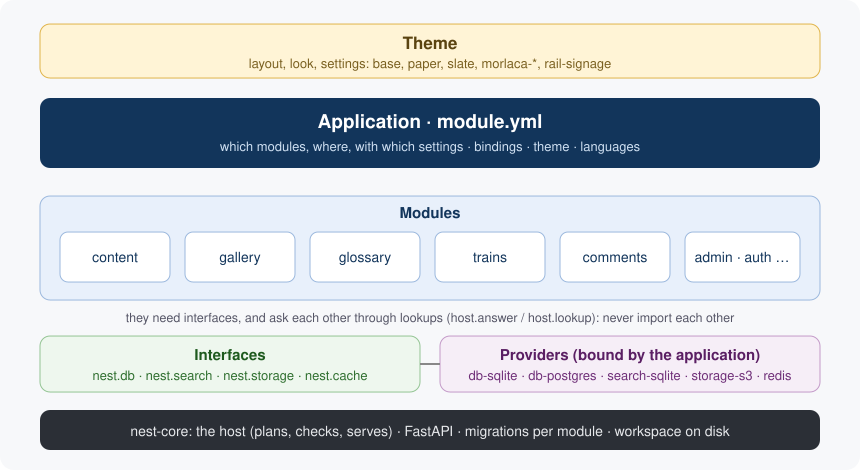

# Concepts

This page explains the words used across the documentation. Each section is short;
the linked pages go further.




## Packages and their types

Everything in Nest is a **package**: a folder with a `module.yml` (what Nest knows
it as) and a `pyproject.toml` (how Python installs it). Its code is in
`src/<package>/`. The manifest's `type` says what kind of package it is:

| Type | What it is |
|---|---|
| `application` | A site. It lists modules, binds interfaces to providers, names a theme, and runs on one port with its own workspace. |
| `module` | Reusable code: routes, templates, settings, admin pages, tables. It owns no port; an application mounts it at a route. |
| `interface` | A named contract (`nest.db`, `nest.search`) with no implementation. Code depends on it, never on a provider. |
| `provider` | Implements one or more interfaces, with typed settings (`db-sqlite`, `search-sqlite`). |
| `theme` | The layout, styles and widgets every page is drawn in. |

Each manifest is checked against the contract for its type. An ecosystem can add
types of its own through its contract. See
[The manifest](../develop/manifest.md).

## Binding

A **binding** connects an interface to the provider that implements it, in the
application's `bind:` section:

```yaml
bind:
  nest.db:
    providers: [db-postgres]
    config:
      db-postgres: {host: db.lan, database: mysite, user: mysite, sslmode: require}
```

Modules ask for `nest.db` and get whichever provider the application chose. That is
why the same module runs on SQLite on a laptop and PostgreSQL on a server.

## Catalog and plan

The **catalog** is every package Nest can see: installed packages, and an
application's local modules (in its `modules/` folder). `nest catalog` lists it.

The **plan** is what Nest works out from an application's manifest and the catalog:
which packages it uses (including dependencies it did not list), in which order they
start, at which routes, and which provider serves each interface. A missing dependency or an unbound interface
is found here, before anything runs.

```sh
uv run nest plan applications/hello
```

## Workspace

Each application keeps what is its own at run time in its **workspace**:
`$NEST_APP_WORKSPACE`, by default `~/.local/share/nest/<app>/`.

| Path | What it holds |
|---|---|
| `.env` | Secrets and overrides, never committed |
| `data/settings.conf` | Runtime settings changed in the admin panel |
| `data/secret.key` | The signing key, generated in development |
| `data/app.db` | The SQLite database, when `nest.db` is bound to `db-sqlite` |
| `data/search.db` | The search index, with `search-sqlite` |
| `data/modules.yml` | The administrator's choices: modules enabled or disabled, the theme, the languages |
| `media/` | Files the application stores (uploads, imported pictures) |

The code comes from a deploy; the workspace is the site's. A backup
(`nest backup APP`) is the workspace in one archive. See
[Backups and upgrades](../operate/backups-and-upgrades.md).

## Settings

Nest keeps three kinds of configuration apart:

- **Build and deploy facts** go in `module.yml` (routes, bindings, ports).
- **Runtime settings** are declared by each package in its manifest, typed, with a
  default, and changed while the site runs.
- **Secrets** come only from the environment or the workspace's `.env`. A secret
  written in `module.yml` stops the start.

A module declares its settings like this:

```yaml
settings:
  per_page:
    label: Entries per page
    type: int
    default: 10
```

A setting's value is found, first match wins, in:

1. the **environment**, as `NEST_<APP>__<MODULE>__<KEY>` (upper case, with any
   character that is not a letter or digit turned into `_`), for example
   `NEST_MY_SITE__CONTENT__PER_PAGE=20` or `NEST_HELLO__CACHE_MEMORY__MAX_ITEMS=500`;
2. the **settings store** (`data/settings.conf`), written by the admin panel's
   Settings page;
3. the application's **manifest**, under the module's `config:`;
4. the module's **default**.

A value set in the environment is shown in the admin panel but cannot be changed
there. A secret is never shown. Most settings apply at once; a setting marked
`restart: true` decides which routes exist, so changing it remakes the application.

## Lookups and answers

Modules cooperate without importing each other. One module **answers** a named
question; others **look it up**:

```python
# in the gallery module's setup
host.answer("gallery.spotlight", spotlight)

# in the content module, only if some module answers
if nest.answered("gallery.spotlight"):
    shown = nest.lookup("gallery.spotlight", {"html": body, ...})
```

`lookup` returns the first answer that is not `None`. `gather` collects every
module's answer: the admin panel gathers `admin.waiting` to show how many comments
wait, and the SEO module gathers `seo.urls` from every module for the
sitemap. If nobody answers, the feature is simply absent. See
[Lookups](../develop/lookups.md).

## Fallbacks

A **fallback** answers a GET request that no route matched. It returns a response,
or `None` to pass it on. Fallbacks are asked by priority, highest first. The content
module (priority 10) serves pages by their stored path, such as
`/history/the-church/`; the redirects module (priority -10) is asked last, so a page
that exists always wins over a redirect.

## Background tasks

A module can run a task from startup until shutdown with `@host.background`. Under
`nest serve`, every worker runs it. With `@host.background(single=True)` only one
worker of the workspace runs it at a time (a daily fetch, a clean-up); if that
worker stops, another takes over. The keeper watches its sites this way.

## Migrations, per module

A module that owns tables ships its own Alembic migrations and keeps its own version
table (`<module>_alembic_version`). Its tables carry its prefix (`content_term`), so
autogenerate never touches another module's tables.

```sh
uv run nest db status applications/my-site
uv run nest db upgrade applications/my-site
```

In development the application upgrades itself at start. In production it refuses
to start while migrations are pending (`NEST_MIGRATE=check`), and you run
`nest db upgrade` as part of the deploy. See [Database](../develop/database.md).

## Locales

Every package lists its translation catalogs, JSON files that map the English text
to its translation:

```yaml
locales:
  - {locale: ro, file: locales/ro.json}
```

Templates write `{{ _("Sign in") }}`. The application's own catalogs load last, so
it can reword any module. A visitor's language comes from their choice, then the
browser, then the site's default. See [Languages](../languages.md).

## Roles

Accounts come from the `auth` module and have roles. Modules protect pages with
`require_role("editor")`. The roles used by Nest's modules are `admin` (has every
role), `editor` (content, galleries, maps, SEO, redirects) and
`moderator` (comments, forum).

## Core, enabled, disabled

In an application's `modules:` list, `core: true` marks a module that can never be
disabled or uninstalled. Others can be turned off and on in the admin panel or with
`nest modules`; the choice is kept in the workspace. See
[Modules and applications](../guide/modules-and-applications.md).
