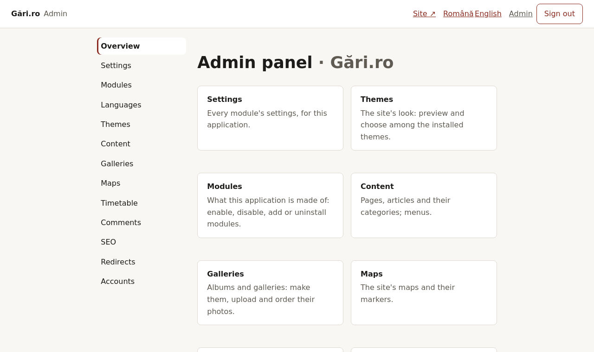

# Your first application

An application is a folder with a `module.yml` that says what the site is made of.
In this page you create one, run it, add modules to it and sign in to its admin
panel. Everything runs from the root of your Nest checkout (see [Install](install.md)).

## Scaffold it

```sh
uv run nest new app my-site --into applications
```

`nest new app NAME` creates a folder named after the application in the folder
given by `--into` (the current folder by default). A name is lower-case letters,
digits and `-`. The command refuses to overwrite a folder that exists.

It writes four files:

| File | What it is |
|---|---|
| `module.yml` | The application's manifest: its identity, port, theme and modules |
| `modules/home/module.yml` | The manifest of a local module, `home`, that belongs to this application only |
| `modules/home/home/__init__.py` | Its code: one route, `/`, and a `setup(host)` that mounts it |
| `modules/home/templates/index.html` | Its page, which extends the theme's `layout.html` |

Run it:

```sh
uv run nest plan applications/my-site
uv run nest run applications/my-site
```

> [!WARNING]
> The scaffold sets `port: 8000`, which is also the keeper's port. If you run the
> keeper, change `application.port` in `module.yml` first, or pass `--port` to
> `nest run`.

## The application's module.yml

The scaffold's manifest is short:

```yaml
module:
  name: my-site
  id: nest.app.my-site
  type: application
  title: My Site
  version: 0.1.0
  created: "2026-11-20"

application:
  title: My Site
  port: 8000
  theme: base

modules:
  - name: home
    route: /

deploy:
  service: my-site
```

The sections you will use most:

| Section | What it says |
|---|---|
| `module` | Who the package is. `type: application` makes it runnable. |
| `application` | How it runs: `title`, `port`, `theme`, `languages`, `theme_settings`, and a few more (`default_language`, `language_urls`, `admin_frame`) |
| `modules` | The modules it mounts, each with a `route` and optional `config` |
| `bind` | Which provider implements each interface it needs (`nest.db`, `nest.search`, `nest.storage`...) |
| `deploy` | Facts for deployment, such as the service name |

### modules: route and config

Each entry names a module. `route` is where its pages are served; a module without
pages (such as `notifications`) needs none. `config` sets the module's settings for
this application:

```yaml
modules:
  - name: content
    route: /
    config:
      per_page: 20
```

The settings a module accepts are listed on its reference page, for example
[the content module](/docs/reference/modules/content). A value set here is a
default: an administrator can still change it in the admin panel, and the
environment can override both (see [Concepts](concepts.md#settings)).

### bind: interfaces to providers

Modules never use a database or a search engine directly. They use an interface,
and the application says which provider implements it:

```yaml
bind:
  nest.db:
    providers: [db-sqlite]
  nest.search:
    providers: [search-sqlite]
  nest.storage:
    providers: [storage-local]
```

A provider's settings go under `config`, by provider name:

```yaml
bind:
  nest.cache:
    providers: [cache-memory]
    config:
      cache-memory:
        max_items: 1000
```

If a module needs an interface the application does not bind, `nest plan` says so.

### theme, languages, theme_settings

```yaml
application:
  title: My Site
  port: 8600
  theme: paper
  languages: [en, ro]          # the first is the default
  theme_settings:
    paper:
      tagline: "Notes from the valley"
```

`theme` names the theme the site starts with; an administrator can choose another
in the admin panel. `languages` lists the languages the site speaks.
`theme_settings` gives the theme's settings, by theme name; which settings a theme
has is on its reference page. See [Themes](../themes.md) and
[Languages](../languages.md).

## Add modules

Here the site gets pages, galleries, accounts and an admin panel. Replace the
`modules` and add a `bind` section:

```yaml
application:
  title: My Site
  port: 8600
  theme: base
  languages: [en, ro]

modules:
  - name: content
    route: /
  - name: home
    route: /hello
  - name: auth
    route: /account
    core: true
  - name: admin
    route: /admin
    core: true
  - name: media
    route: /media
  - name: gallery
    route: /gallery
  - name: notifications

bind:
  nest.db:
    providers: [db-sqlite]
  nest.search:
    providers: [search-sqlite]
  nest.storage:
    providers: [storage-local]
```

Why each line is there:

- `content` serves pages at whole-site addresses (`/about/`, `/news/my-post/`), so
  it must be mounted at `/`. The `home` module moves out of its way.
- `media` serves stored files; content and gallery store their pictures through it.
  `/media` is the conventional route, which imported pages assume.
- `auth` gives accounts and sign-in; `admin` is the panel. `core: true` means they
  can never be disabled from the panel.
- `notifications` shows short messages ("Saved.") after an action. It has no pages.
- `content` needs `nest.db`, `nest.search` and `nest.storage`; `gallery` needs
  `nest.db` and `nest.storage`. The `bind` section provides them.

Check the result before you run it:

```sh
uv run nest plan applications/my-site
```

The plan lists every package in start order, including the ones pulled in as
dependencies (`htmx`, the interfaces, the providers), and the bindings. If something
is missing or mounted wrongly, the plan or the start says what and where.

When the application starts, each module's migrations run and create its tables in
the workspace's SQLite database. You do not run anything by hand in development.

## Create an administrator

Create the first account from the command line. `--password-stdin` reads the
password from standard input, so it does not end up in your shell history:

```sh
uv run nest auth create-user applications/my-site ana@example.org --role admin --password-stdin
```

Type the password and press Enter (or pipe it in). `--role` can be repeated for
several roles, and `--name` sets a display name. The `admin` role includes every
other role.

> [!TIP]
> Registration is closed by default (the `auth` module's `allow_registration`
> setting), but the very first account can always register on the site itself, at
> `/account/register` here, and it becomes the administrator.

## The admin panel

Run the site and open the panel:

```sh
uv run nest run applications/my-site     # http://127.0.0.1:8600/admin/
```

You are sent to sign in, then land on the panel's home. It shows a tile for each
part of the panel your roles open:



- **Settings**: every module's settings, and every theme's, changed on the running
  site.
- **Themes**: preview the installed themes and choose one.
- **Modules**: enable, disable, add or uninstall modules.
- **Languages**: which languages the site is in.
- One tile per module with admin pages: **Content**, **Galleries**,
  **Accounts**...

Nobody writes an admin panel for an application: it is made of the admin pages of
the modules the application includes. See [The admin panel](../guide/admin-panel.md).

## Next

- Learn [the concepts](concepts.md): bindings, the workspace, settings, lookups.
- Choose and configure modules: [Modules and applications](../guide/modules-and-applications.md).
- Add pages and photos: [Content and media](../guide/content-and-media.md).
- Write a module of your own: [A module](../develop/a-module.md).
