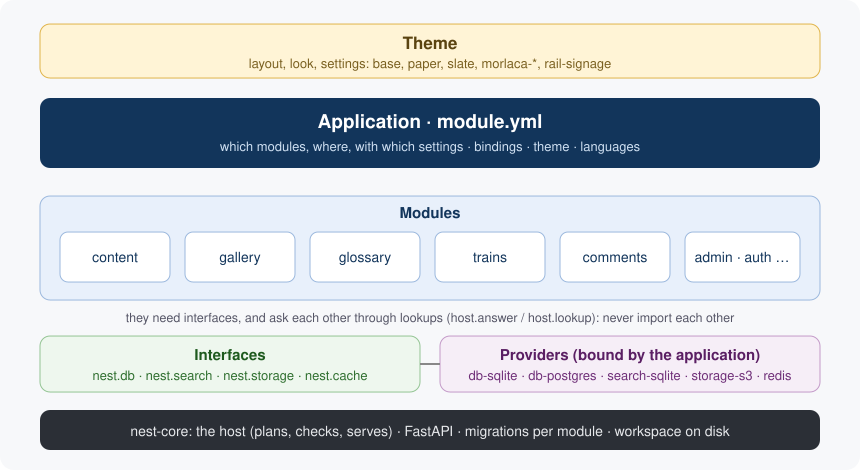

# What Nest is

Nest is a Python framework for web sites and web applications made of reusable parts.
It is built on FastAPI and renders pages on the server. Pages are made livelier with
htmx and Server-Sent Events, and Vue is used only where a page really needs it.

You describe a site in one short file, its `module.yml`: which modules it uses, at
which addresses, with which theme and languages. Nest reads that file, checks it,
works out the order to start things in, and runs the site as **one service on one
port**, with its own data folder.

## Who it is for

- **People who run several sites** that need the same things (pages, galleries,
  comments, sign-in, search engines, an admin panel) and do not want to maintain
  each one separately.
- **Developers** who want to write a feature once, as a module, and use it on many
  sites, each in its own look.
- **Small servers.** Nest is meant to be light: SQLite by default, no build step
  for most pages, and settings that change without a restart.

## What a site is made of

A Nest site is built in layers. Each layer only knows the one below it through a
published name, never through its internals.



| Layer | What it is | Example |
|---|---|---|
| **Application** | The site itself: a `module.yml` that lists modules, binds interfaces to providers, and names a theme and languages. It runs on one port. | `applications/hello`, `../mysite` |
| **Module** | Reusable code with routes, templates, settings, admin pages and its own tables. It owns no port; the application mounts it at a route. | `content`, `gallery`, `comments`, `forum` |
| **Interface** | A named contract with no implementation. Modules depend on it, never on a particular provider. | `nest.db`, `nest.search`, `nest.storage`, `nest.cache` |
| **Provider** | An implementation of an interface, with its own settings. The application chooses one. | `db-sqlite`, `db-postgres`, `search-sqlite`, `storage-local` |
| **Theme** | The layout every page is drawn in, its styles and widgets. Modules fill it. | `base`, `paper`, `slate`, `rail-signage` |

Because a module codes against `nest.db` and not against SQLite, moving a site from
SQLite to PostgreSQL is a change of binding in the manifest. The module code stays
the same.

Every package (module, interface, provider, theme, application) has the same two
files at its root:

- `module.yml`: what Nest knows it as (its identity, what it gives and what it needs);
- `pyproject.toml`: how Python builds and installs it.

The manifest is checked against a contract for its type when the site starts, so a
mistake is reported at once instead of on the first request.

## A small example

This is the whole description of Nest's demonstration application,
`applications/hello/module.yml`, shortened:

```yaml
module:
  name: hello
  id: nest.app.hello
  type: application
  version: 0.2.0

application:
  title: Hello, Nest
  port: 8100
  theme: base

modules:
  - name: home
    route: /
  - name: auth
    route: /auth
  - name: forum
    route: /forum
  - name: messages
    route: /mesaje

bind:
  nest.db:
    providers: [db-sqlite]
  nest.cache:
    providers: [cache-memory]
```

From this, Nest knows that `forum` needs `auth` and a database, that the database is
SQLite, and that everything is drawn in the `base` theme.

## What comes with it

The repository holds the host and a set of packages any site can use:

| Folder | What is in it |
|---|---|
| `packages/nest-core` | The host: manifests, contracts, planning, bindings, security, SSE and the `nest` command |
| `modules/` | `admin`, `auth`, `content`, `media`, `gallery`, `maps`, `geo`, `comments`, `forum`, `messages`, `notifications`, `glossary`, `hangman`, `seo`, `redirects`, `translations`, `trains`, `forms`, `htmx`, `docs`, `agent`, `scheduler`, `keeper`, `registry` |
| `interfaces/` | `cache`, `db`, `pubsub`, `search`, `storage` |
| `providers/` | `cache-memory`, `redis`, `db-sqlite`, `db-postgres`, `db-mariadb`, `search-sqlite`, `storage-local`, `storage-s3` |
| `themes/` | `base`, `paper`, `slate`, `rail-signage`, and the morlaca themes |
| `engines/saga` | Saga, an engine for life-simulation browser games, and its subsystems |
| `applications/` | Nest's own applications: `hello`, `keeper`, `registry`, `docsite` |

Every module has a reference page, for example
[the content module](/docs/reference/modules/content).

## What Nest is not

- **Not a hosted service.** You run it yourself: on a laptop with `nest run`, on a
  server with `nest serve` behind a web server, or in a container. See
  [Deploying](../deploy.md).
- **Not a single-page-application framework.** Pages are rendered on the server.
  JavaScript is added where it helps, never required to read a page.
- **Not a page builder.** Sites are composed from modules in a manifest and
  configured in the admin panel. There is no drag-and-drop layout editor.
- **Not a microservice platform.** One site is one process (or one set of workers)
  on one port. Modules talk to each other inside it, not over the network.
- **Not WordPress.** It can import WordPress, Geticus and Glossword sites and keep
  their addresses, but it does not run their plugins or themes.

## Next

- [Install Nest](install.md) and run the demonstration application.
- [Write your first application](first-application.md).
- Learn [the vocabulary](concepts.md) used across this documentation.
